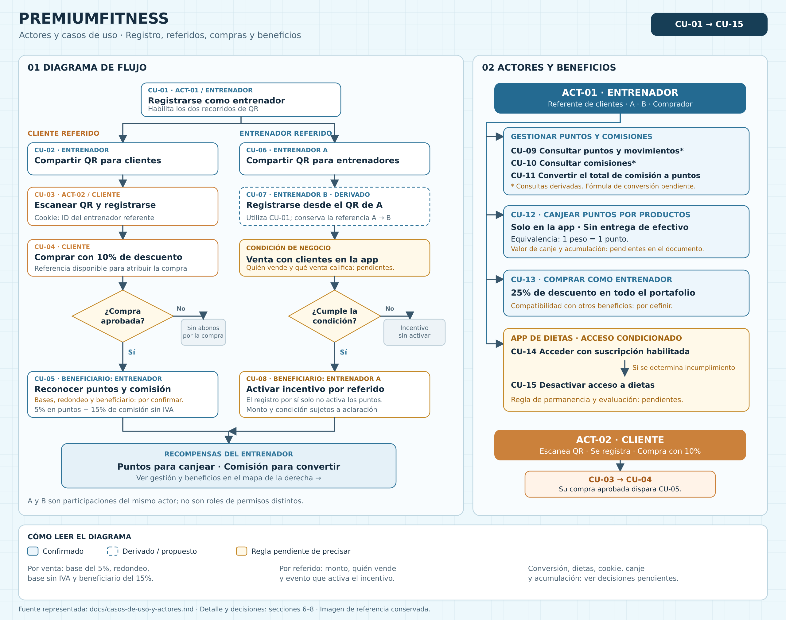

# Actores y casos de uso — PremiumFitness

## 1. Propósito y fuentes

Este documento describe quiénes interactúan con la app, qué objetivos persiguen, los flujos para alcanzarlos y las reglas que condicionan cada operación.

La fuente de verdad es [requerimientos.md](requerimientos.md). El [diagrama de flujo](img/diagrama-flujo.jpg) se utiliza únicamente como apoyo visual. Ante una diferencia, prevalece el texto de requisitos. Este documento no sustituye las decisiones de negocio pendientes ni convierte las propuestas de diseño en requisitos aprobados.

Se emplean tres categorías:

- **Confirmado:** comportamiento expresamente indicado en los requisitos.
- **Derivado:** comportamiento propuesto para hacer operable, verificable o comprensible un requisito. Requiere validación antes de incorporarse al alcance definitivo.
- **Pendiente:** regla incompleta, contradictoria o ausente que impide definir una parte del comportamiento con precisión.

**Confirmado por producto** marca el comportamiento que el responsable del producto confirmó después de redactar `requerimientos.md` y que ese archivo todavía no recoge. No contradice la fuente de verdad, pero debe incorporarse a ella. El 7 de noviembre de 2026 se confirmó que PremiumFitness replica la gestión de pedidos de `backend-radical-nutrition`:

- El agente del call center procesa cada pedido en el admin.
- El pedido se registra en SAP Business One.
- El despacho sale de la bodega SAP asignada a cada ciudad.
- Se registran la guía y la transportadora para el seguimiento.

El 9 de noviembre de 2026 se confirmó además:

- El QR es una forma de presentar el enlace del entrenador, que lleva su id en base64 y se puede compartir por cualquier medio.
- Cada entrenador tiene un cupón. Un cliente que se registró sin enlace puede escribirlo después.
- Clientes y entrenadores usan apps distintas, cada una en su subdominio.
- Los porcentajes de descuento, puntos y comisión son configurables, con excepciones por producto.
- Los puntos se calculan con IVA incluido; solo la comisión discrimina el IVA.

Los flujos de error y controles identificados como derivados son recomendaciones de especificación. No implican que exista una implementación actual.

### 1.1. Diagrama de actores y casos de uso

El diagrama resume los casos de uso CU-01 a CU-15. Todavía no incluye al agente del call center ni CU-16 a CU-19, que se añadirán al redibujarlo. Muestra los recorridos de clientes y entrenadores referidos, los actores que participan y la gestión de beneficios. Distingue los casos derivados y las reglas pendientes de precisar. A y B representan participaciones del entrenador, no roles de permisos diferentes.

[Abrir imagen en tamaño completo](img/actores-y-casos-de-uso.png) · [Versión vectorial editable (SVG)](img/actores-y-casos-de-uso.svg)

## 2. Alcance funcional

El alcance confirmado comprende:

1. Registro de entrenadores y clientes.
2. Referidos mediante dos enlaces del entrenador, uno para clientes y otro para entrenadores, que se comparten por cualquier medio o como QR.
3. Asociación del cliente con el entrenador, por el enlace o por su cupón.
4. Compras de clientes con un descuento del 10%.
5. Reconocimiento al entrenador del 5% en puntos (con IVA incluido) y del 15% de comisión sin IVA cuando una compra es aprobada. Los porcentajes son configurables por producto.
6. 50.000 puntos por referir a otro entrenador, que se activan con la primera compra aprobada de un cliente del referido.
7. Conversión del total de la comisión a puntos (comisión + 50% de los puntos vigentes, con tope en la comisión) o pago en dinero de la comisión no convertida al final de cada mes.
8. Canje de puntos por productos exclusivamente a través de la app.
9. Descuento del 25% para entrenadores en todo el portafolio.
10. Acceso a una app de dietas bajo una modalidad de suscripción condicionada por una regla de negocio pendiente.

Confirmado por producto (7 de noviembre de 2026):

11. Procesamiento de cada pedido pagado por un agente del call center desde el admin, con registro en SAP Business One.
12. Envío del pedido desde la bodega SAP asignada a la ciudad de entrega, con número de guía y transportadora.
13. Seguimiento del pedido por parte del comprador: estado y guía.

No están especificados el proveedor de pagos, el procedimiento de retiro o liquidación de comisiones, el cobro del envío, las devoluciones, la administración del catálogo, los campos de registro ni los mecanismos de autenticación del portal. Estos elementos no se incorporan como funciones confirmadas.

## 3. Actores

### 3.1. Actores principales

| ID | Actor | Objetivo | Interacciones | Estado |
| --- | --- | --- | --- | --- |
| ACT-01 | Entrenador | Obtener herramientas, descuentos y recompensas por compras de clientes y referidos. | Registrarse; compartir sus dos enlaces (o QR); acceder a dietas; recibir puntos y comisiones; convertir comisiones; canjear puntos; comprar con descuento. | Confirmado. |
| ACT-02 | Cliente | Registrarse, asociarse a un entrenador por su enlace o su cupón, y comprar con el beneficio correspondiente. | Abrir el enlace o escanear el QR; registrarse; escribir el cupón si no tiene entrenador; realizar compras con descuento; consultar el seguimiento de sus pedidos. | Confirmado; el seguimiento, confirmado por producto. |
| ACT-03 | Agente del call center | Procesar los pedidos pagados hasta su envío. | Iniciar sesión en el admin; tomar o liberar pedidos; registrar el pedido en SAP; registrar guía y transportadora; actualizar el estado. | Confirmado por producto. |

El agente no es un usuario del portal ni un rol de `users`. Es un empleado de la intranet de la empresa e inicia sesión en el admin con esas credenciales, como en radical.

### 3.2. Participaciones del entrenador

Estas denominaciones distinguen participantes de una operación. **No son roles de permisos diferentes** según los requisitos disponibles.

| Participación | Descripción | Ejemplo |
| --- | --- | --- |
| Entrenador referente de clientes | Comparte su enlace para clientes o recibe clientes por su cupón, y es el destinatario de los beneficios de las compras atribuidas. | Un entrenador comparte su enlace por WhatsApp con un cliente que luego compra. |
| Entrenador A o referente de entrenadores | Comparte el enlace para entrenadores y recibe 50.000 puntos cuando un cliente de B compra por primera vez. | A invita a B. |
| Entrenador B o referido | Recibe el enlace para entrenadores y se registra en la app de entrenadores. | B se registra a partir del enlace de A. |
| Entrenador comprador | Utiliza el descuento del 25% o canjea puntos por productos. | Un entrenador compra un producto del portafolio. |

Una misma persona puede participar en varias de estas situaciones. No se define si una misma cuenta puede ser simultáneamente cliente y entrenador.

### 3.3. Participantes previos al registro y sistemas de apoyo

| Participante o sistema | Relación con los casos de uso | Tratamiento |
| --- | --- | --- |
| Persona aún no registrada | Inicia el registro de cliente o entrenador. | Estado previo de ACT-01 o ACT-02; no se asume un tercer rol de negocio. |
| App de clientes que conserva el id del enlace | Mantiene el identificador del entrenador entre la apertura del enlace y el registro o login (cookie o almacenamiento del navegador). | Mecanismo técnico confirmado; no es un actor de negocio. Su soporte en una app nativa está pendiente. |
| Origen del estado de compra «Aprobada» | Proporciona el evento que habilita las recompensas por venta. | La condición existe, pero los requisitos no indican quién la informa. Derivado de radical: la pasarela de pagos confirma el pago por webhook y el pedido pasa a «Aprobada». El proveedor sigue pendiente (D-10). |
| Pasarela de pagos | Cobra el pedido e informa el resultado del pago. | Derivado de radical. No es un actor de negocio. |
| SAP Business One | Recibe el pedido que registra el agente y devuelve el código del pedido SAP. Define los artículos y las bodegas. | Sistema externo, confirmado por producto. |
| Transportadora | Transporta el pedido y expone el rastreo de la guía. En radical: Servientrega, Melonn y Envía. | Sistema externo, confirmado por producto. Las transportadoras de PremiumFitness están por confirmar. |
| Intranet de la empresa | Contiene los empleados con los que el agente inicia sesión en el admin. | Sistema externo, confirmado por producto. Falta confirmar que es la misma intranet que usa radical. |
| App de dietas | Proporciona la herramienta de dietas al entrenador. | Beneficio confirmado. Falta definir si pertenece al mismo sistema o es una integración externa. |

No se incluyen como actores un operador de bodega ni un soporte, porque ni los requisitos ni las confirmaciones de producto los describen. La preparación física del despacho ocurre fuera de la app.

## 4. Reglas de negocio y trazabilidad

| ID | Regla | Estado y precisión | Referencia en requisitos |
| --- | --- | --- | --- |
| RN-01 | El entrenador se registra y comparte dos enlaces: uno para clientes, que abre la app de clientes, y otro para entrenadores, que abre la app de entrenadores. Cada enlace lleva el id del entrenador en base64. El QR es una forma de presentar el enlace; también se comparte por redes sociales o WhatsApp. | Confirmado; enlaces y apps separadas confirmados por producto el 9 nov 2026. | Inicio del archivo y lista de tipos de QR. |
| RN-02 | Al abrir el enlace, la app de clientes guarda el id del entrenador y lleva al login. Al registrarse o iniciar sesión, el cliente sin entrenador queda asociado a ese entrenador. | Confirmado; el login como destino y la asociación al iniciar sesión los confirmó producto el 9 nov 2026. | «El cliente escanea, se registra…». |
| RN-03 | El cliente asociado a un entrenador ve todo el catálogo con descuento: badge con el porcentaje, precio con descuento y precio real tachado. El descuento por defecto es del 10%. | Confirmado; el catálogo con descuento lo confirmó producto el 9 nov 2026. Aplica a todas sus compras mientras esté asociado. | «El cliente compra…». |
| RN-04 | Las recompensas al entrenador por una venta se reconocen cuando la compra está aprobada. | Confirmado. Los demás estados no se definen. | «Cuando la compra sea Aprobada…». |
| RN-05 | El entrenador recibe en puntos el 5% de lo que pagó el cliente por los productos (con descuento y con IVA, sin envío), calculado sobre el total del pedido y redondeado al entero más cercano. | Confirmado; base, redondeo y envío definidos por producto el 9 nov 2026. | Párrafo de aprobación y beneficio 1. |
| RN-06 | El entrenador recibe una comisión sobre el valor sin IVA de cada producto comprado. El porcentaje por defecto es del 15% y puede variar por producto (RN-22). | Confirmado por el párrafo de aprobación; existe una contradicción posterior sobre el beneficiario. | Párrafo de aprobación y beneficio 2. |
| RN-07 | El entrenador A recibe 50.000 puntos por referir a otro entrenador (B). Quedan pendientes al registrarse B y se activan una sola vez con la primera compra aprobada de un cliente de B, sin monto mínimo. La compra propia de B no los activa. Los puntos pendientes no caducan; una vez activados, vencen a los 6 meses. | Confirmado por producto (9 nov 2026). El monto es la variable de entorno `TRAINER_REFERRAL_POINTS`. | Párrafo posterior a «Entrenador comparte qr con otro entrenador». |
| RN-08 | La app de dietas opera en modalidad de suscripción y se desactiva si el entrenador incumple una regla de negocio. | Confirmado. Regla, evaluación y alcance de la desactivación pendientes. | Beneficios para entrenadores, punto 1. |
| RN-09 | Los puntos se canjean por productos exclusivamente en la app; no se entregan en efectivo. | Confirmado. | Beneficios, punto 2, y último párrafo. |
| RN-10 | El entrenador tiene un descuento para todo el portafolio, del 25% por defecto y configurable. | Confirmado. Acumulación con otros beneficios pendiente. | Beneficios para entrenadores, punto 3. |
| RN-11 | La comisión se paga en dinero al final de cada mes. Antes del corte, el entrenador puede convertir su total a puntos: recibe la comisión más el 50% de sus puntos vigentes, con un adicional que no supera la comisión convertida. No hay canje mixto. | Confirmado por producto (9 nov 2026). Medio de pago: términos y condiciones. | Nota sobre conversión de comisiones. |
| RN-12 | Un peso equivale a un punto. | Confirmado. No se especifica tratamiento de fracciones. | Último párrafo. |
| RN-13 | Hay otros beneficios por definir. | Pendiente. No habilita casos de uso concretos. | Beneficios para entrenadores, punto 4. |
| RN-14 | Cada pedido pagado lo procesa un agente del call center, que queda asignado al pedido. | Confirmado por producto. | Confirmación del 7 nov 2026; radical. |
| RN-15 | Un agente solo puede tomar un pedido sin asignar, y solo puede liberar un pedido suyo que todavía no tenga código de pedido SAP. | Derivado de radical. | Radical: tomar y liberar pedido. |
| RN-16 | El pedido se registra en SAP Business One y conserva el código del pedido SAP. Cada línea conserva el código del artículo SAP. | Confirmado por producto. | Confirmación del 7 nov 2026; radical. |
| RN-17 | El despacho sale de la bodega SAP asignada a la ciudad de entrega. Cada ciudad tiene hasta tres bodegas en orden de prioridad. | Confirmado por producto. | Confirmación del 7 nov 2026; radical. |
| RN-18 | El envío se registra con número de guía y transportadora, que se guardan juntos. | Confirmado por producto. | Confirmación del 7 nov 2026; radical. |
| RN-19 | El comprador puede consultar el estado de su pedido y, cuando existe guía, el rastreo en la transportadora. | Confirmado por producto. No se define un historial de cambios de estado. | Confirmación del 7 nov 2026; radical. |
| RN-20 | Cada entrenador tiene un cupón con nombre único. Un cliente sin entrenador puede asociarse escribiendo ese cupón. Un cliente ya asociado no ve el campo del cupón y no cambia de entrenador por sí mismo. | Confirmado por producto. | Confirmación del 9 nov 2026. |
| RN-21 | Un cliente sin entrenador puede comprar a precio completo; su compra no genera descuento ni recompensas. | Confirmado por producto. | Confirmación del 9 nov 2026. |
| RN-22 | Los porcentajes no están fijos en el código. Descuento del cliente, descuento del entrenador, puntos y comisión tienen valores por defecto (10%, 25%, 5% y 15%) que, como los 50.000 puntos por referido, los 6 meses de vencimiento y el 50% de conversión, se definen en variables de entorno. Cada producto puede tener una estrategia propia; por ejemplo, Nutra Balance da un 5% más de descuento (15%) y su comisión baja al 10%. | Confirmado por producto. Falta definir quién administra las estrategias y si pueden tener vigencia. | Confirmación del 9 nov 2026. |

### 4.1. Interpretación de importes y porcentajes

- **Puntos por venta:** los puntos del pedido = suma de lo pagado por los productos (con descuento y con IVA, sin el envío) × porcentaje de puntos (5% por defecto), redondeado una sola vez al entero más cercano (0,5 sube). Un peso equivale a un punto.
- **Ejemplo de puntos:** una Bipro de 249.900 con 10% de descuento se paga 224.910; `224.910 × 0,05 = 11.245,5` → **11.246 puntos**. **Diferencia con requerimientos.md:** su ejemplo asigna 12.500 puntos sobre el precio completo; prevalece la definición de producto del 9 nov 2026 (los puntos se ganan sobre lo que el cliente pagó).
- **Comisión:** por cada línea, `comisión = base sin IVA × porcentaje de comisión del producto` (15% por defecto; por ejemplo, 10% en Nutra Balance). No se debe confundir «quitar el IVA» con restar directamente una tasa al precio final. Los requisitos no definen las tasas ni el desglose tributario del pedido.
- **Descuentos:** el 10% del cliente y el 25% del entrenador son valores por defecto. Cada producto puede tener su propio porcentaje (RN-22). Quedan pendientes la interacción con otras promociones, el envío y el orden de aplicación de descuentos e impuestos.
- **Conversión (confirmada el 9 nov 2026):** puntos recibidos = comisión + mín(50% × puntos vigentes, comisión). Con 100.000 puntos y 100.000 de comisión queda con 250.000 puntos. El ejemplo del original (100.000 → 50.000) corresponde al 50% sobre los puntos vigentes; el tope es decisión de producto.

La restricción de no entregar efectivo se refiere al canje de puntos. La comisión sí se paga en dinero al final de cada mes (confirmado el 9 nov 2026); los términos y condiciones definen el medio y el plazo.

## 5. Catálogo de casos de uso

| ID | Caso de uso | Actor o participante principal | Base |
| --- | --- | --- | --- |
| CU-01 | Registrar entrenador | Entrenador por registrarse | Confirmado; detalles del formulario pendientes. |
| CU-02 | Compartir el enlace para clientes | Entrenador | Confirmado; enlace confirmado por producto. |
| CU-03 | Registrar cliente y asociarlo al entrenador del enlace | Cliente por registrarse | Confirmado. |
| CU-04 | Comprar como cliente con descuento | Cliente | Confirmado; proceso de compra no detallado. |
| CU-05 | Reconocer puntos y comisión por compra aprobada | Entrenador beneficiario; evento de aprobación como disparador | Confirmado; cálculos incompletos. |
| CU-06 | Compartir el enlace para entrenadores | Entrenador A | Confirmado; enlace confirmado por producto. |
| CU-07 | Registrar entrenador referido | Entrenador B | Derivado del flujo confirmado de referidos. |
| CU-08 | Activar los 50.000 puntos por entrenador referido | Entrenador A beneficiario; primera compra aprobada de un cliente de B como disparador | Confirmado por producto (9 nov 2026). |
| CU-09 | Consultar puntos y movimientos | Entrenador | Derivado para permitir el uso informado de puntos. |
| CU-10 | Consultar comisiones | Entrenador | Confirmado por producto (9 nov 2026). |
| CU-11 | Convertir el total de la comisión a puntos | Entrenador | Confirmado por producto (9 nov 2026). |
| CU-12 | Canjear puntos por productos | Entrenador | Confirmado; reglas de canje incompletas. |
| CU-13 | Comprar como entrenador con descuento | Entrenador comprador | Confirmado; acumulación pendiente. |
| CU-14 | Acceder a la app de dietas | Entrenador | Confirmado; condiciones de habilitación pendientes. |
| CU-15 | Desactivar acceso a dietas por incumplimiento | Entrenador afectado; evaluación de regla como disparador | Confirmado; evaluación pendiente. |
| CU-16 | Tomar o liberar un pedido en el admin | Agente del call center | Confirmado por producto; liberación derivada de radical. |
| CU-17 | Registrar el pedido en SAP | Agente del call center | Confirmado por producto. |
| CU-18 | Registrar el envío del pedido | Agente del call center | Confirmado por producto. |
| CU-19 | Consultar el seguimiento del pedido | Cliente o entrenador comprador | Confirmado por producto. |
| CU-20 | Asociar el cupón de un entrenador | Cliente sin entrenador | Confirmado por producto. |
| CU-21 | Liquidar la comisión del mes | Cron y usuario del admin | Confirmado por producto; medio de pago pendiente (términos y condiciones). |

## 6. Especificación de casos de uso

### CU-01. Registrar entrenador

- **Objetivo:** incorporar a una persona como entrenador para que pueda participar en los beneficios y referidos.
- **Actor:** ACT-01, antes de completar su registro.
- **Disparador:** la persona descarga o abre la app e inicia su registro como entrenador.
- **Precondición:** disponer de acceso a la app. Los requisitos no definen plataformas ni tiendas de distribución.
- **Reglas:** RN-01.

**Flujo principal:**

1. La persona inicia el registro de entrenador.
2. La app solicita los datos de registro; los campos están pendientes de definición.
3. La persona proporciona los datos y elige el nombre de su cupón. El sistema verifica que el cupón no esté en uso. Esta verificación es derivada de join.nutramerican.com.
4. El sistema registra al entrenador con su cupón.
5. El entrenador puede compartir sus dos enlaces y su cupón.

**Alternativas y errores:** la validación de datos, el tratamiento de cuentas existentes y la verificación de identidad o contacto son aspectos derivados por definir. Si el registro no se completa, no debe comunicarse como exitoso.

**Resultado:** entrenador registrado. La activación inicial de dietas y otros beneficios sujetos a condiciones se define por separado.

**Criterio de aceptación:** dado un registro completado, el entrenador tiene un cupón único y puede compartir el enlace para clientes y el enlace para entrenadores. No se acredita un bono de bienvenida, porque no aparece en la fuente de verdad.

### CU-02. Compartir el enlace para clientes

- **Objetivo:** invitar a un cliente y asociarlo al entrenador.
- **Actor:** ACT-01 como referente de clientes.
- **Disparador:** el entrenador decide invitar a un cliente.
- **Precondición:** entrenador registrado.
- **Reglas:** RN-01 y RN-02.

**Flujo principal:**

1. El entrenador abre en su app el enlace para clientes. El enlace apunta a la app de clientes y lleva su id en base64.
2. Lo comparte como prefiera: copia el enlace, lo envía por WhatsApp, lo publica en redes sociales o muestra el QR que lo contiene.
3. El cliente abre el enlace y continúa en CU-03.

**Alternativas y errores:** un enlace con un id inválido o de un entrenador inactivo no asocia a nadie; el cliente sigue al login sin entrenador. El id en base64 no está cifrado: cualquiera puede decodificarlo, lo que se acepta porque el enlace solo atribuye ventas.

**Resultado:** invitación compartida. Compartir el enlace no genera por sí mismo puntos ni comisión.

**Criterio de aceptación:** el enlace para clientes abre la app de clientes e identifica al entrenador; no se confunde con el enlace para entrenadores. El QR muestra el mismo enlace.

### CU-03. Registrar cliente y asociarlo al entrenador del enlace

- **Objetivo:** que el cliente quede asociado al entrenador que lo invitó.
- **Actor:** ACT-02.
- **Disparador:** el cliente abre el enlace del entrenador.
- **Precondición:** enlace con el id de un entrenador activo.
- **Reglas:** RN-02, RN-03 y RN-20.

**Flujo principal:**

1. El cliente abre el enlace. La app de clientes guarda el id del entrenador y muestra el login.
2. Si el cliente no tiene cuenta, se registra. Si ya la tiene, inicia sesión; el guard lo deja pasar y lo lleva al dashboard.
3. El sistema asocia al cliente con el entrenador del enlace. La asociación queda guardada en la base de datos, no solo en el navegador.
4. Desde ese momento, el catálogo muestra el descuento en todos los productos y el campo del cupón no aparece.

**Alternativas y errores:**

- **Cliente que se registra sin enlace:** queda sin entrenador; puede asociarse después con CU-20.
- **Cliente ya asociado que abre el enlace de otro entrenador:** conserva su entrenador. RN-20 no permite cambiarlo por sí mismo.
- **Cliente ya registrado, sin entrenador, que abre un enlace:** al iniciar sesión queda asociado al entrenador del enlace.
- **El navegador pierde el id antes del registro:** el cliente puede asociarse luego con el cupón (CU-20).

**Resultado:** cliente registrado y asociado al entrenador.

**Criterio de aceptación:** después del registro desde el enlace, el cliente tiene un entrenador asociado en la base de datos, ve el catálogo con descuento y no ve el campo del cupón.

### CU-04. Comprar como cliente con descuento

- **Objetivo:** adquirir productos con el descuento de cliente asociado a un entrenador.
- **Actor:** ACT-02.
- **Disparador:** el cliente inicia una compra en la app.
- **Precondiciones:** cliente registrado. Para tener descuento, debe estar asociado a un entrenador (CU-03 o CU-20).
- **Reglas:** RN-03, RN-04, RN-21 y RN-22.

**Flujo principal:**

1. El cliente ve el catálogo con el descuento de cada producto: badge con el porcentaje, precio con descuento y precio real tachado.
2. Elige los productos. El sistema aplica a cada línea el descuento vigente del producto: el valor por defecto (10%) o el de su estrategia (RN-22).
3. La app presenta el total, el descuento y el IVA antes de pagar.
4. El cliente completa el proceso de compra que se defina.
5. El sistema guarda en el pedido el cupón del entrenador asociado, con el porcentaje y el monto del descuento. Así la compra queda atribuida a ese entrenador.
6. Cuando la compra alcanza el estado «Aprobada», se inicia CU-05 y, si corresponde, se evalúa CU-08.
7. El pedido aprobado queda disponible en el admin para que un agente lo procese y lo envíe (CU-16 a CU-18). El cliente puede seguirlo en CU-19.

**Alternativas y errores:**

- **Compra sin aprobación:** no se otorgan todavía las recompensas de CU-05.
- **Cliente sin entrenador:** compra a precio completo y no genera recompensas (RN-21). Puede asociarse antes de pagar con CU-20.
- **Nueva compra del mismo cliente:** conserva el descuento mientras siga asociado al entrenador.
- **Cancelación, rechazo o devolución:** los estados y sus efectos sobre beneficios no están definidos.

**Resultado:** compra registrada con el descuento correspondiente; las recompensas dependen de su aprobación.

**Criterio de aceptación:** cada línea aplica el descuento vigente de su producto, y el pedido guarda el cupón del entrenador. Crear una compra sin aprobación no basta para acreditar puntos y comisión al entrenador.

### CU-05. Reconocer puntos y comisión por compra aprobada

- **Objetivo:** reconocer al entrenador las dos recompensas de la compra atribuida.
- **Beneficiario:** ACT-01 como referente de clientes.
- **Disparador:** una compra del cliente alcanza el estado «Aprobada». No se requiere una solicitud manual del entrenador según el flujo descrito.
- **Precondiciones:** compra aprobada, entrenador referente identificable e importes de cálculo disponibles.
- **Reglas:** RN-04, RN-05, RN-06 y RN-12.

**Flujo principal:**

1. El sistema reconoce la aprobación de la compra.
2. Identifica al entrenador por el cupón guardado en el pedido.
3. Calcula los puntos: los puntos del pedido = suma de lo pagado por los productos (con descuento y con IVA, sin el envío) × porcentaje de puntos (5% por defecto), redondeado una sola vez al entero más cercano (0,5 sube).
4. Por cada línea, obtiene la base sin IVA.
5. Calcula la comisión de cada línea con el porcentaje vigente del producto (15% por defecto; menor si el producto tiene un descuento extra) y suma las líneas.
7. Acredita los puntos y reconoce la comisión al entrenador.
8. Como comportamiento derivado, conserva la relación entre compra, entrenador y movimientos para permitir su consulta y verificación.

**Alternativas y errores:**

- **Compra no aprobada:** el caso no se ejecuta.
- **Entrenador no identificable o importes insuficientes:** se propone no acreditar una recompensa calculada con datos incompletos y dejar la incidencia identificable; tratamiento operativo pendiente.
- **Aprobación recibida más de una vez:** se propone evitar duplicar puntos y comisión por la misma compra. Es un control derivado.
- **Devolución posterior:** no se define reversión, retención ni descuento de saldos.

**Resultado:** puntos y comisión reconocidos al entrenador por la compra aprobada. Esto no equivale a un pago o retiro de la comisión.

**Criterios de aceptación:** una compra aprobada atribuida produce ambas recompensas. Los puntos se calculan con IVA incluido y la comisión sobre la base sin IVA, con el porcentaje de cada producto. Ejemplo: una línea de Nutra Balance genera comisión al 10%, no al 15%. El ejemplo de 249.900 queda validado al resolver la discrepancia entre 12.495 y 12.500.

**Pendiente relevante:** se utiliza al entrenador como beneficiario por la instrucción explícita del párrafo de aprobación. La frase posterior que asigna el 15% al cliente debe corregirse o confirmarse.

### CU-06. Compartir el enlace para entrenadores

- **Objetivo:** invitar a otro entrenador.
- **Actor:** ACT-01 como entrenador A.
- **Disparador:** A decide invitar a otro entrenador.
- **Precondición:** A está registrado.
- **Reglas:** RN-01 y RN-07.

**Flujo principal:**

1. A abre en su app el enlace para entrenadores. El enlace apunta a la app de entrenadores (otro subdominio) y lleva el id de A en base64.
2. A lo comparte por WhatsApp, redes sociales o QR.
3. B lo abre y continúa en CU-07.

**Alternativas y errores:** un id inválido no identifica a A; B puede registrarse sin referente.

**Resultado:** invitación a B compartida. Compartir el enlace no basta para activar los 50.000 puntos.

**Criterio de aceptación:** el enlace para entrenadores abre la app de entrenadores e identifica a A; no se confunde con el enlace para clientes.

### CU-07. Registrar entrenador referido

- **Objetivo:** registrar a B y dejar pendientes los 50.000 puntos de A.
- **Actor:** ACT-01 como entrenador B; A participa como referente.
- **Disparador:** B abre el enlace para entrenadores de A.
- **Precondiciones:** A registrado y enlace con su id.
- **Reglas:** RN-01 y RN-07.
- **Clasificación:** Confirmado por producto (9 nov 2026).

**Flujo principal:**

1. B abre el enlace compartido por A en la app de entrenadores.
2. El sistema identifica a A como referente.
3. B completa CU-01.
4. Se guarda la relación A → B con 50.000 puntos pendientes para A. El valor se toma de la variable de entorno `TRAINER_REFERRAL_POINTS` y queda fijado en el referido.
5. Los puntos pendientes no se pueden canjear y no caducan. B no gana puntos por registrarse.

**Alternativas y errores:** si B se registra sin el enlace de A, no queda referido por A: no hay cupón para entrenadores. B tiene un solo referente. El autorreferido y un B ya registrado siguen pendientes (D-05).

**Resultado:** B registrado y 50.000 puntos pendientes para A.

**Criterio de aceptación:** al registrarse B desde el enlace de A, A ve 50.000 puntos pendientes que no suman a su saldo canjeable.

### CU-08. Activar los 50.000 puntos por entrenador referido

- **Objetivo:** dar a A sus 50.000 puntos cuando un cliente de B compra por primera vez.
- **Beneficiario:** ACT-01 como entrenador A.
- **Disparador:** se aprueba el pago de una compra de un cliente asociado a B.
- **Precondiciones:** relación A → B con los puntos pendientes.
- **Reglas:** RN-04, RN-05 y RN-07.
- **Clasificación:** Confirmado por producto (9 nov 2026).

**Flujo principal:**

1. Se aprueba el pago de la compra de un cliente de B. No hay monto mínimo.
2. B recibe sus puntos y su comisión normales por esa compra (CU-05).
3. El sistema comprueba si B tiene un referente con los puntos pendientes.
4. Si los tiene, guarda el pedido que los activó y la fecha, y crea para A un lote de 50.000 puntos disponibles que vence a los 6 meses.
5. Todo ocurre en la misma transacción que la aprobación: un pago notificado dos veces no duplica los puntos.

**Alternativas y errores:**

- **Se activan una sola vez:** las compras siguientes de los clientes de B no le dan más puntos a A.
- **Compra propia de B:** no activa los puntos de A.
- **Pago no aprobado:** no activa nada.
- **Cancelación o devolución de la compra que los activó:**
  - Si A no ha usado los puntos, se le retiran y vuelven a quedar pendientes hasta la siguiente compra aprobada de un cliente de B.
  - Si los usó en parte, se retira solo el remanente.
  - Si los usó por completo, los conserva.

**Resultado:** 50.000 puntos disponibles para A, una sola vez por referido.

**Criterio de aceptación:**

- Dado A → B pendiente, cuando se aprueba la primera compra de un cliente de B, A recibe un lote de 50.000 puntos.
- Una segunda compra aprobada no crea otro lote.
- Una compra aprobada de B como comprador no crea ningún lote para A.

### CU-09. Consultar puntos y movimientos

- **Objetivo:** que el entrenador vea en todo momento los puntos ganados por sus clientes y por los entrenadores que refirió.
- **Actor:** ACT-01.
- **Clasificación:** Confirmado por producto (9 nov 2026).
- **Disparador:** el entrenador abre su dashboard o la consulta de puntos.
- **Precondición:** entrenador con sesión iniciada.
- **Reglas relacionadas:** RN-05, RN-07, RN-09, RN-11 y RN-12.

**Flujo principal:**

1. El entrenador abre su dashboard.
2. **Puntos por compras de sus clientes:** el sistema muestra el total acumulado histórico y los puntos vigentes (disponibles y no vencidos).
3. **Puntos por los entrenadores que refirió con su enlace:** muestra los puntos vigentes, los pendientes y el detalle por cada entrenador B (pendiente, activo con su remanente, usado o vencido).
4. Muestra el saldo canjeable total, la suma de los puntos vigentes de todos los orígenes, y los lotes que vencen pronto.
5. Permite ver los movimientos: abonos por compras, puntos por referido activados, conversiones, canjes, vencimientos y ajustes.

**Alternativas y errores:** sin movimientos, muestra cero y la ausencia de movimientos de forma explícita. Un entrenador no puede ver los datos de otro.

**Resultado y aceptación:**

- Las cifras responden de inmediato porque se calculan con índices que cubren la consulta (spec `specs/negocio/03-saldos-del-entrenador.md`).
- Un lote vencido deja de contar como vigente en cuanto pasa su fecha, aunque el proceso de vencimiento no haya corrido.
- Cada lote vence a los 6 meses de su acumulación.

### CU-10. Consultar comisiones

- **Objetivo:** conocer la comisión del mes que puede convertir a puntos o que se le pagará al final del mes.
- **Actor:** ACT-01.
- **Clasificación:** Confirmado por producto (9 nov 2026).
- **Disparador:** el entrenador abre su dashboard o la consulta de comisiones.
- **Precondición:** entrenador con sesión iniciada.

**Flujo principal:**

1. El sistema muestra el saldo de comisión sin liquidar: abonos por ventas aprobadas, menos conversiones, más o menos ajustes.
2. Indica la fecha del próximo corte: el último día del mes.
3. Permite relacionar cada abono con el pedido y las líneas que lo originaron, con el porcentaje de comisión que aplicó a cada producto.
4. Muestra las conversiones y las liquidaciones mensuales anteriores, con su estado (cerrada o pagada).

**Alternativas y errores:** sin comisiones, muestra un saldo de cero.

**Resultado y aceptación:** el entrenador sabe cuánto puede convertir hoy (CU-11) y cuánto recibirá en dinero si no convierte (CU-21).

### CU-11. Convertir el total de la comisión a puntos

- **Objetivo:** transformar la comisión en puntos para canjear productos.
- **Actor:** ACT-01.
- **Disparador:** el entrenador solicita la conversión desde la app de entrenadores.
- **Precondiciones:** saldo de comisión mayor que cero y conversión no bloqueada por el corte mensual.
- **Reglas:** RN-09, RN-11, RN-12 y reglas 16 y 17 de `reglas-de-negocio.md`.
- **Clasificación:** Confirmado por producto (9 nov 2026).

**Flujo principal:**

1. El entrenador abre la conversión.
2. El sistema calcula:
   - `C`, el saldo total de comisión;
   - `P`, sus puntos vigentes de todos los orígenes, sin los 50.000 por referido pendientes;
   - el adicional: `mín(50% × P, C)`;
   - los puntos que recibirá: `C + adicional`, redondeado al entero más cercano.
3. Muestra la comisión que se convierte, los puntos vigentes, el adicional, los puntos que recibirá, el saldo de puntos resultante y el vencimiento del nuevo lote (6 meses).
4. Muestra el aviso: «La comisión que conviertas a puntos no se te pagará en dinero al final del mes. Esta operación no se puede deshacer.»
5. El entrenador confirma con un botón; no hay campo de importe.
6. En una sola transacción, el sistema:
   - registra la conversión con `C`, `P`, el porcentaje, el adicional y el total;
   - debita la comisión;
   - crea el lote de puntos.

**Ejemplo:** con 100.000 puntos vigentes y 100.000 de comisión, recibe 100.000 + 50.000 = 150.000 y queda con 250.000 puntos.

**Alternativas y errores:**

- **Saldo cambiado antes de confirmar:** el servidor recalcula y pide confirmar de nuevo.
- **Solicitud repetida:** no convierte dos veces.
- **Corte mensual en curso:** la conversión queda bloqueada unos minutos con un mensaje.
- **Conversión parcial:** no existe.

**Resultado:** comisión convertida y lote de puntos disponible para canjear.

**Criterio de aceptación:** los ejemplos de la regla 17 dan exactamente los puntos indicados, y una comisión no se convierte dos veces.

### CU-12. Canjear puntos por productos

- **Objetivo:** utilizar puntos para obtener productos a través de la app.
- **Actor:** ACT-01.
- **Disparador:** el entrenador inicia un canje.
- **Precondiciones:** puntos disponibles y productos ofrecidos para canje. Las condiciones de disponibilidad de productos no están definidas.
- **Reglas:** RN-09 y RN-12.

**Flujo principal:**

1. El entrenador ingresa al recorrido de canje en la app.
2. Selecciona los productos que desea obtener.
3. El sistema determina los puntos necesarios aplicando la equivalencia de un peso por punto al valor de canje que se acuerde.
4. Como comportamiento derivado, muestra los productos, los puntos requeridos y el saldo resultante.
5. El entrenador solicita completar el canje.
6. El sistema aplica los puntos al canje y registra los productos correspondientes. La forma de descontar o reservar el saldo está pendiente de diseño.

**Alternativas y errores:**

- **Puntos insuficientes:** no se presupone pago mixto de dinero y puntos; debe definirse si se admite.
- **Solicitud de efectivo:** no corresponde a un canje permitido.
- **Canje fuera de la app:** no corresponde al canal autorizado por RN-09.
- **Producto no disponible o canje cancelado:** reposición de puntos, reserva de inventario y devolución están pendientes.
- **Uso del descuento del 25%:** no se presume su acumulación con el canje.

**Resultado:** canje registrado por productos. Como propuesta derivada, el canje sigue el mismo procesamiento y envío que una compra (CU-16 a CU-19). Falta confirmar si se registra en SAP y con qué documento (PD-18). Los tiempos de cumplimiento no están especificados.

**Criterios de aceptación:** el canje se realiza en la app y entrega productos como contraprestación; no permite retirar los puntos en efectivo. El descuento del saldo debe corresponder al valor de canje confirmado.

### CU-13. Comprar como entrenador con descuento

- **Objetivo:** adquirir productos del portafolio con el descuento del 25%.
- **Actor:** ACT-01 como comprador.
- **Disparador:** el entrenador inicia una compra propia.
- **Precondición:** su condición de entrenador puede verificarse; requisitos adicionales de elegibilidad no definidos.
- **Reglas:** RN-10.

**Flujo principal:**

1. El entrenador selecciona productos del portafolio.
2. El sistema aplica el descuento del 25% según la base de cálculo que se defina.
3. Como comportamiento derivado, presenta el beneficio y el total de la compra para revisión.
4. El entrenador completa la compra mediante el proceso que se defina.
5. El pedido aprobado sigue el procesamiento y envío de CU-16 a CU-18, y el entrenador puede seguirlo en CU-19.

**Alternativas y errores:** la acumulación con promociones, puntos o el descuento de cliente no está definida. No se establece que una compra propia genere el 5% en puntos o el 15% de comisión; esas recompensas se describen para compras de clientes.

**Resultado:** compra propia del entrenador con el 25% de descuento en el portafolio.

**Criterio de aceptación:** se reconoce el 25% a la compra elegible del entrenador sin excluir categorías del portafolio por una regla inventada. Las bases de impuestos y envío deben validarse por separado.

### CU-14. Acceder a la app de dietas

- **Objetivo:** utilizar la herramienta de dietas ofrecida como beneficio.
- **Actor:** ACT-01.
- **Disparador:** el entrenador solicita acceso a dietas.
- **Precondiciones:** entrenador registrado y acceso habilitado conforme a la modalidad de suscripción que se defina.
- **Reglas:** RN-08.

**Flujo principal:**

1. El entrenador solicita ingresar a la app de dietas.
2. El sistema verifica si su acceso está habilitado. Esta verificación es un detalle derivado de la posibilidad de desactivación.
3. Si está habilitado, permite utilizar la herramienta de dietas.

**Alternativas y errores:** si el beneficio está desactivado por incumplimiento, no se permite usarlo conforme a CU-15. Se propone informar el motivo y la condición de recuperación cuando esas reglas estén definidas.

**Resultado:** acceso a la herramienta cuando corresponda.

**Criterio de aceptación:** se puede diferenciar un entrenador con acceso habilitado de uno con acceso desactivado. No se especifican creación de dietas, asignación a clientes, planes nutricionales ni edición, porque los requisitos solo nombran el beneficio.

**Pendientes:** activación inicial, posible cobro, periodicidad, integración con otra app y funciones concretas de dietas. La palabra «suscripción» no confirma por sí sola un pago periódico.

### CU-15. Desactivar acceso a dietas por incumplimiento

- **Objetivo:** aplicar la condición de permanencia del beneficio de dietas.
- **Participante afectado:** ACT-01.
- **Disparador:** se determina que el entrenador no cumple la regla de negocio.
- **Precondiciones:** regla de permanencia definida, datos para evaluarla y acceso previamente habilitado.
- **Reglas:** RN-08.

**Flujo principal condicionado a aclaración:**

1. Se evalúa al entrenador según la regla y el periodo que se acuerden.
2. Se determina que no cumple la condición.
3. Se desactiva su acceso a la app de dietas.
4. Como comportamiento derivado, se conserva el motivo y se informa al entrenador en el siguiente intento de acceso.

**Alternativas y errores:**

- **Cumple la regla:** el acceso no se desactiva por este motivo.
- **No hay datos suficientes para evaluar:** el tratamiento está pendiente; no se debe equiparar automáticamente una evaluación fallida con incumplimiento.
- **Vuelve a cumplir:** reactivación, plazos y responsable no están definidos.

**Resultado:** acceso a dietas desactivado por incumplimiento conforme a la regla aprobada.

**Criterio de aceptación condicionado:** una vez definida la regla, se desactiva el acceso en el supuesto que corresponda. No hay fundamento en los requisitos para extender esa desactivación a la cuenta, las comisiones o los puntos.

### CU-16. Tomar o liberar un pedido en el admin

- **Objetivo:** que cada pedido pagado tenga un único agente responsable de procesarlo.
- **Actor:** ACT-03.
- **Disparador:** el agente abre la bandeja de pedidos por procesar en el admin.
- **Precondiciones:** el agente inició sesión en el admin con sus credenciales de la intranet, y el pedido está aprobado.
- **Reglas:** RN-14 y RN-15.

**Flujo principal:**

1. El agente consulta la bandeja de pedidos operativos. Como en radical, la bandeja muestra por defecto los pedidos aprobados que aún no tienen código de pedido SAP, con filtros por fecha, estado y búsqueda.
2. Abre el detalle de un pedido: comprador, documento, dirección y ciudad de entrega, productos, total y estado del pago.
3. Toma el pedido. El sistema lo asigna al agente solo si no tiene otro agente asignado.
4. El pedido queda a su cargo y continúa en CU-17.

**Alternativas y errores:**

- **Pedido ya tomado por otro agente:** el sistema no cambia la asignación e informa quién lo tiene.
- **Liberar el pedido:** el agente puede liberarlo si es suyo y todavía no tiene código de pedido SAP. El pedido vuelve a la bandeja.
- **Pedido con código SAP:** ya no se puede liberar; se considera procesado.
- **Reasignación por un supervisor:** radical permite cambiar el agente de un pedido. Faltan definir quién puede hacerlo y con qué permisos (PD-22).

**Resultado:** pedido asignado a un agente o devuelto a la bandeja.

**Criterio de aceptación:** dos agentes no pueden tomar el mismo pedido, y un pedido con código SAP no puede liberarse.

### CU-17. Registrar el pedido en SAP

- **Objetivo:** que el pedido exista en SAP Business One para facturarlo y despacharlo.
- **Actor:** ACT-03.
- **Disparador:** el agente procesa un pedido que tiene asignado.
- **Precondiciones:** pedido aprobado y asignado al agente. Comprador identificable en SAP por tipo y número de documento. Productos con código de artículo SAP.
- **Reglas:** RN-16 y RN-17.

**Flujo principal:**

1. El agente revisa en el detalle del pedido los artículos SAP de cada línea y la ciudad de entrega.
2. El sistema indica las bodegas SAP asignadas a esa ciudad, en orden de prioridad.
3. El agente crea el pedido en SAP Business One con el socio de negocio, los artículos y la bodega correspondiente.
4. El agente registra en el admin el código del pedido SAP. El sistema lo guarda solo si el pedido sigue asignado a ese agente o no tiene agente; en ese caso, se lo asigna.
5. El pedido queda procesado y continúa en CU-18.

**Alternativas y errores:**

- **Comprador inexistente en SAP:** falta definir si el agente lo crea en SAP o si el usuario debe existir antes (PD-21).
- **Producto sin artículo SAP:** el pedido no puede registrarse hasta corregir el maestro de productos.
- **Ciudad sin bodega asignada:** falta definir la bodega por defecto.
- **Pedido tomado por otro agente:** el sistema rechaza el código.

**Resultado:** pedido registrado en SAP, con su código guardado en la app.

**Criterio de aceptación:** un pedido procesado tiene código de pedido SAP y agente asignado, y cada línea conserva el código del artículo SAP con el que se facturó.

**Pendiente relevante:** en radical, el agente registra el pedido en SAP de forma manual. Si en PremiumFitness se envía de forma automática, este caso cambia (PD-23).

### CU-18. Registrar el envío del pedido

- **Objetivo:** dejar constancia del despacho para que el comprador pueda rastrearlo.
- **Actor:** ACT-03.
- **Disparador:** la transportadora genera la guía del pedido.
- **Precondiciones:** pedido registrado en SAP (CU-17).
- **Reglas:** RN-18 y RN-19.

**Flujo principal:**

1. El agente registra en el admin el número de guía y la transportadora.
2. El sistema guarda ambos datos juntos.
3. El agente actualiza el estado del pedido a «ENVIADO».
4. El comprador ve el nuevo estado y la guía en CU-19.

**Alternativas y errores:**

- **Guía sin transportadora o transportadora sin guía:** no se acepta.
- **Guía incorrecta:** el agente puede corregirla. Como no se guarda un historial, el valor anterior se pierde (PD-19).
- **Cancelación o devolución después del envío:** los estados existen en radical, pero sus efectos sobre puntos y comisiones siguen pendientes (PD-13).

**Resultado:** pedido enviado, con guía y transportadora.

**Criterio de aceptación:** un pedido enviado muestra guía y transportadora, y su estado es «ENVIADO».

### CU-19. Consultar el seguimiento del pedido

- **Objetivo:** que el comprador sepa en qué estado está su pedido y dónde va el envío.
- **Actor:** ACT-02, o ACT-01 como comprador o en un canje.
- **Disparador:** el comprador abre el detalle de uno de sus pedidos.
- **Precondición:** comprador autenticado.
- **Reglas:** RN-19.

**Flujo principal:**

1. El comprador abre la lista de sus pedidos y elige uno.
2. El sistema muestra el estado, los productos, el total y la dirección de entrega.
3. Si el pedido tiene guía, el sistema consulta el rastreo en la transportadora y lo muestra.

**Alternativas y errores:**

- **Sin guía:** se muestra solo el estado.
- **Transportadora no disponible:** se muestran el estado y la guía, con un aviso de que el rastreo no está disponible en ese momento.
- **Pedido de otro usuario:** no se muestra. Es un control derivado.

**Resultado:** el comprador conoce el estado y el rastreo de su pedido.

**Criterio de aceptación:** un pedido con guía muestra el rastreo de la transportadora, y un comprador solo ve sus propios pedidos.

### CU-20. Asociar el cupón de un entrenador

- **Objetivo:** que un cliente registrado sin enlace obtenga el descuento y quede asociado a un entrenador.
- **Actor:** ACT-02.
- **Disparador:** el cliente escribe el nombre del cupón en la app de clientes.
- **Precondición:** cliente autenticado y sin entrenador asociado. El campo del cupón solo se muestra en ese caso.
- **Reglas:** RN-03, RN-20 y RN-21.

**Flujo principal:**

1. El cliente escribe el cupón.
2. El sistema busca el entrenador activo con ese cupón.
3. Asocia al cliente con ese entrenador y guarda que la asociación vino del cupón.
4. El catálogo pasa a mostrar los descuentos y el campo del cupón desaparece.

**Alternativas y errores:**

- **Cupón inexistente o de un entrenador inactivo:** se informa y el cliente sigue sin entrenador.
- **Cliente ya asociado:** el campo no se muestra; si la petición llega igual, se rechaza.

**Resultado:** cliente asociado al entrenador del cupón.

**Criterio de aceptación:** con un cupón válido, el cliente queda asociado y ve los descuentos. Con un cupón inválido no cambia nada.

### CU-21. Liquidar la comisión del mes

- **Objetivo:** cerrar el mes, dejar calculado lo que la empresa debe pagar a cada entrenador por la comisión que no convirtió, y entregar el reporte mensual.
- **Actores:** cron del hosting para el cierre y usuario del admin para registrar el pago.
- **Disparador:** el día 1 a la 01:00 (hora de Colombia), el cron del hosting hace una sola petición de cierre del mes anterior, con `year` y `month` explícitos. No se usa un programador dentro de la aplicación.
- **Reglas:** regla 18 de `reglas-de-negocio.md`; spec `specs/negocio/05-reportes-y-conciliacion-mensual.md`.
- **Clasificación:** Confirmado por producto (9 nov 2026). El proceso se toma del sistema actual (api-comisiones), simplificado. Medio de pago y destinatarios pendientes.

**Flujo principal:**

1. El sistema valida el secreto del cierre y el período.
2. En una sola transacción:
   - crea el período del mes;
   - crea una liquidación por cada entrenador con comisión sin liquidar (pedidos, comisión, ajustes, lo convertido y el total a pagar);
   - marca los movimientos como liquidados;
   - registra el débito que deja el saldo en cero.
3. Genera el Excel del mes fuera de la carpeta pública con estas hojas: resumen por entrenador, análisis de ventas, detalle de pedidos, productos, puntos, canjes y cuadre.
4. Envía al administrador un correo con el resumen y un enlace que exige iniciar sesión.
5. La empresa paga por fuera de la app. El agente registra en el admin la fecha y la referencia del pago de cada liquidación.

**Alternativas y errores:**

- **Mes ya cerrado:** responde 409 y no toca nada. Con `force` solo regenera el Excel y reenvía el correo; nunca recalcula importes.
- **Total negativo** (por devoluciones): no se paga nada y la diferencia pasa al mes siguiente.
- **Devolución o corrección posterior al cierre:** entra como ajuste en el mes siguiente. Un mes cerrado no cambia.
- **Fallo del correo:** el cierre queda hecho y el correo se reenvía con `force`.

**Resultado:** período cerrado, liquidaciones por entrenador, reporte disponible y, después, pagos registrados.

**Criterio de aceptación:**

- Cuadre de comisión: comisión del mes ± ajustes − convertido = total liquidado.
- Cuadre de puntos: saldo inicial + emitidos − canjeados − vencidos ± ajustes = saldo final.
- Disparar dos veces el cierre produce un solo período y un solo correo.

## 7. Recorridos completos y dependencias

### 7.1. Compra de cliente referido

1. El entrenador se registra: CU-01.
2. Comparte su enlace para clientes, por WhatsApp, redes o QR: CU-02.
3. El cliente abre el enlace, se registra y queda asociado: CU-03. Si se registró sin enlace, escribe el cupón: CU-20.
4. El cliente ve el catálogo con descuento y compra: CU-04.
5. Al aprobarse la compra, el entrenador recibe los puntos (5% con IVA incluido) y la comisión (15% sin IVA, o el porcentaje del producto): CU-05.
6. Un agente procesa y envía el pedido (CU-16 a CU-18), y el cliente lo sigue en CU-19.
7. El entrenador puede canjear sus puntos: CU-12. Puede convertir el total de su comisión a puntos antes del corte: CU-11. Lo que no convierta se le paga en dinero al final del mes: CU-21.

### 7.2. Referido de entrenador

1. A comparte el enlace para entrenadores: CU-06.
2. B se registra desde ese enlace: CU-07, que utiliza CU-01.
3. Un cliente de B hace su primera compra y se aprueba el pago: CU-04 y CU-05.
4. Se activan para A los 50.000 puntos, una sola vez: CU-08.
5. A puede utilizar los puntos activados en CU-12.

Confirmado por producto (9 nov 2026): la compra que activa los puntos es de un cliente de B.

### 7.3. Acceso condicionado a dietas

1. El entrenador solicita usar dietas: CU-14.
2. Su acceso depende de la suscripción y la regla de permanencia que se acuerden.
3. Si se determina incumplimiento, se aplica CU-15.

El origen y la frecuencia de la evaluación no están definidos. No se vincula automáticamente a una cuota de ventas ni a la vigencia de los puntos.

### 7.4. Procesamiento y envío del pedido

1. El comprador paga el pedido y la pasarela lo aprueba (CU-04 o CU-13; CU-12 si el canje sigue este flujo).
2. Un agente toma el pedido en el admin: CU-16.
3. Lo registra en SAP con los artículos y la bodega de la ciudad de entrega: CU-17.
4. Registra la guía y la transportadora y marca el pedido como enviado: CU-18.
5. El comprador consulta el estado y el rastreo: CU-19.

Las recompensas de CU-05 dependen de la aprobación del pago (paso 1), no del envío.

## 8. Inconsistencias y decisiones pendientes

| ID | Tema | Evidencia o vacío | Decisión necesaria | Casos afectados |
| --- | --- | --- | --- | --- |
| PD-01 | Beneficiario del 15% | El párrafo de aprobación dice «entrenador»; el beneficio 2 dice «cliente». | Confirmar y unificar el beneficiario. Este documento sigue provisionalmente la instrucción explícita del párrafo de aprobación. | CU-05, CU-10, CU-11. |
| PD-02 | Base de los puntos | Resuelto el 9 nov 2026: lo pagado por los productos, con descuento y con IVA, sin el envío, sobre el total del pedido. | Ninguna. | CU-04, CU-05. |
| PD-03 | Redondeo de puntos | Resuelto el 9 nov 2026: una sola vez por pedido, al entero más cercano (0,5 sube). | Ninguna. | CU-05, CU-09. |
| PD-04 | Base de comisión | Se exige retirar el IVA, sin detallar descuentos, tasas, envío o pedidos con tratamientos tributarios diferentes. | Definir la base sin IVA por compra o por producto. | CU-05. |
| PD-05 | Puntos por referido | **Resuelta (9 nov 2026):** son 50.000 puntos, definidos en la variable de entorno `TRAINER_REFERRAL_POINTS`. | — | CU-08. |
| PD-06 | Compra que activa el referido | **Resuelta (9 nov 2026):** la primera compra aprobada de cualquier cliente de B, una sola vez y sin monto mínimo; la compra propia de B no cuenta. Si se cancela o devuelve y A no ha usado los puntos, vuelven a quedar pendientes. | — | CU-07, CU-08. |
| PD-07 | Conversión de comisión | **Resuelta (9 nov 2026):** total de la comisión; puntos recibidos = comisión + mín(50% × puntos vigentes, comisión). | — | CU-10, CU-11. |
| PD-08 | Permanencia en dietas | Se menciona una regla de negocio sin describirla. | Definir condición, periodo de evaluación, activación inicial, desactivación y reactivación. | CU-14, CU-15. |
| PD-09 | Suscripción de dietas | No se define si hay pago o si depende de actividad comercial. | Definir modalidad y funciones de la herramienta. | CU-14, CU-15. |
| PD-10 | Enlace y asociación | Resuelto en parte el 9 nov 2026: la asociación se guarda en la cuenta y no se cambia por el cliente. Falta definir cuánto tiempo guarda la app el id del enlace antes del registro. | Definir el almacenamiento temporal del id. | CU-02, CU-03. |
| PD-11 | Continuidad del descuento | Resuelto el 9 nov 2026: el descuento aplica a todo el catálogo mientras el cliente esté asociado. | Ninguna. | CU-04. |
| PD-12 | Acumulación y valoración | No se indica si descuentos, promociones y puntos se combinan ni cuál es el precio de canje. | Definir compatibilidad, base del descuento y valor de productos en puntos. | CU-04, CU-12, CU-13. |
| PD-13 | Aprobación y reversión | No se define quién informa la aprobación ni qué ocurre con cancelaciones o devoluciones. | Definir origen del estado, transición válida y efectos sobre puntos y comisión. Los 50.000 puntos por referido ya tienen regla (CU-08). | CU-04, CU-05, CU-08, CU-12. |
| PD-14 | Liquidación de comisión | **Resuelta (9 nov 2026):** la comisión no convertida se paga en dinero al final de cada mes (CU-21). Pendiente en términos y condiciones: medio, plazo, mínimo y retenciones. | Términos y condiciones. | CU-10, CU-11, CU-21. |
| PD-15 | Mecánica del canje | Sin reglas de pago mixto, inventario, reserva, entrega o cancelación. | Definir qué hace efectivo el canje y cuándo se consumen o restituyen puntos. | CU-12. |
| PD-16 | Registro y acceso | No hay campos, credenciales, verificación ni coexistencia de roles. | Definir datos mínimos, identificación y permisos. | CU-01, CU-03, CU-07 y consultas. |
| PD-17 | Otros beneficios | Se enumeran como «por definir». | Describir cada beneficio antes de crear sus casos de uso. | Sin caso específico. |
| PD-18 | Canjes en SAP y envío | No se define si el canje pasa por el call center, si se registra en SAP ni con qué documento, porque no hay cobro. | Definir el procesamiento del canje y su documento en SAP. | CU-12, CU-16 a CU-18. |
| PD-19 | Historial de estados | Radical guarda solo el estado actual y la guía vigente. | Definir si el comprador o la operación necesitan ver cada cambio con su fecha. | CU-18, CU-19. |
| PD-20 | Cobro del envío | En el checkout retail de radical, el flete se cobra como un producto interno, «Flete». Los requisitos no mencionan el envío. | Definir si se cobra, cómo se calcula y si entra en la base de descuentos, puntos y comisión (relacionado con PD-02 y PD-04). | CU-04, CU-12, CU-13. |
| PD-21 | Cliente en SAP | No se define si los usuarios se crean primero en SAP o en el portal. | Definir quién crea el socio de negocio y cuándo. | CU-01, CU-03, CU-17. |
| PD-22 | Intranet y permisos del admin | Se asume la misma intranet de radical. No se definen perfiles de agente y supervisor. | Confirmar la intranet y quién puede reasignar pedidos o cambiar estados. | CU-16 a CU-18. |
| PD-23 | Registro en SAP manual o automático | En radical, el agente crea el pedido en SAP y registra el código. | Confirmar si se mantiene manual o si se integra con el Service Layer. | CU-17. |
| PD-24 | Cliente registrado sin entrenador que abre un enlace | Resuelto el 9 nov 2026: queda asociado al iniciar sesión. | Ninguna. | CU-03, CU-20. |
| PD-25 | Entrenador B sin enlace | Resuelto el 9 nov 2026: B solo queda referido por A si se registra desde el enlace o QR de A. | Ninguna. | CU-07. |
| PD-26 | Administración de estrategias por producto | No se define quién crea las estrategias de descuento y comisión, ni si tienen vigencia. | Definir responsable, vigencia y auditoría. | CU-04, CU-05. |

## 9. Diferencias entre el diagrama y la fuente de verdad

| Elemento visual | Tratamiento en este documento |
| --- | --- |
| 30.000 puntos de bienvenida | No se incorpora como requisito: no está en requerimientos.md. |
| Puntos con duración de seis meses | No se incorpora caducidad: no está en requerimientos.md. |
| Seminarios de nutrición y materiales de apoyo | No se convierten en casos de uso: el archivo solo menciona otros beneficios por definir. |
| 50.000 puntos por metas/registro | Se conserva el flujo textual de referido condicionado a venta y se señalan monto y condición pendientes. No se crea una recompensa independiente por metas o por simple registro. |
| Un único recorrido de QR visible para clientes | Se documentan los dos tipos de QR exigidos por el archivo: clientes y entrenadores. |
| Conversión de comisión a puntos sin detalle | Se documenta la facultad de conversión, pero se deja pendiente la fórmula ambigua del texto. |
| Beneficios no representados con detalle en la imagen | Se incluyen el descuento del 25%, el canje exclusivo en app, la equivalencia peso/punto y la condición de acceso a dietas porque sí están en el archivo. |

## 10. Cobertura de los requisitos

| Enunciado de la fuente | Actores | Casos que lo cubren | Reglas |
| --- | --- | --- | --- |
| El entrenador descarga la app y se registra. | ACT-01. | CU-01. La descarga se trata como paso previo de distribución, no como función interna. | RN-01. |
| Comparte un QR para clientes. | ACT-01, ACT-02. | CU-02. | RN-01. |
| Cliente escanea, se registra y guarda ID del entrenador en cookie. | ACT-02; ACT-01 como referente. | CU-03; CU-20 con el cupón. | RN-02, RN-20. |
| Cliente compra con 10% de descuento. | ACT-02. | CU-04. | RN-03. |
| Compra aprobada otorga 5% en puntos y 15% sin IVA al entrenador. | ACT-01 como beneficiario. | CU-05; CU-09 y CU-10 como consultas derivadas. | RN-04, RN-05, RN-06, RN-12. |
| Comparte QR con otro entrenador. | ACT-01 como A y B. | CU-06, CU-07. | RN-01, RN-07. |
| 50.000 puntos por referido, sujetos a la primera compra de un cliente de B. | ACT-01 como A beneficiario. | CU-08. | RN-07. |
| App de dietas en suscripción con desactivación por regla. | ACT-01. | CU-14, CU-15. | RN-08. |
| Puntos canjeables por productos, solo en app y sin efectivo. | ACT-01. | CU-12. | RN-09. |
| 25% de descuento para todo el portafolio. | ACT-01. | CU-13. | RN-10. |
| Convertir total de comisión a puntos (comisión + 50% de los vigentes, con tope en la comisión) o recibirla en dinero al final del mes. | ACT-01. | CU-11, CU-21. | RN-11, RN-12. |
| Un peso equivale a un punto. | ACT-01. | CU-05, CU-11, CU-12. | RN-12. |
| Otros beneficios por definir. | ACT-01. | Sin caso hasta definir alcance. | RN-13. |
| Confirmado por producto: el call center procesa cada pedido y lo registra en SAP. | ACT-03. | CU-16, CU-17. | RN-14, RN-15, RN-16, RN-17. |
| Confirmado por producto: envío con guía y transportadora, y seguimiento del comprador. | ACT-03; ACT-01 y ACT-02 como compradores. | CU-18, CU-19. | RN-18, RN-19. |

## 11. Condiciones para cerrar la especificación

La cobertura funcional del texto queda documentada. Las funciones confirmadas por producto (procesamiento, SAP, envío y seguimiento) deben incorporarse también a `requerimientos.md`. Para usar todos los casos como criterios de implementación y pruebas definitivos, se deben resolver las decisiones pendientes, especialmente el beneficiario de la comisión, las bases y redondeos, el incentivo por referido, la conversión de comisión y la condición de dietas.

Los casos derivados de consulta y los controles de consistencia deben validarse como parte del alcance. Cada decisión debe actualizar su regla de negocio, los casos afectados y los criterios de aceptación correspondientes, manteniendo requerimientos.md como fuente de verdad.
