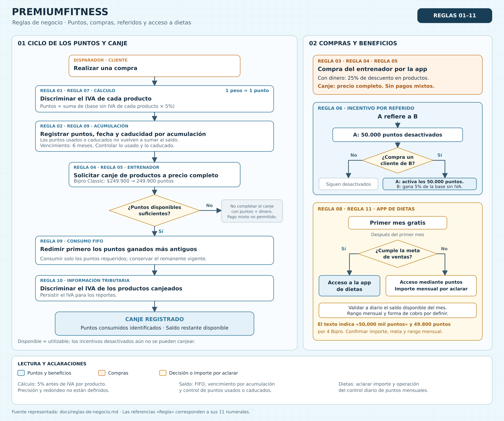

# Reglas de negocio

## Diagrama de flujo

El diagrama resume las reglas 1 a 11 de este documento: cálculo y vencimiento de puntos, canje por FIFO, compras del entrenador, 50.000 puntos por referido y acceso a dietas. Las referencias «Regla» corresponden a los numerales del listado. El importe de dietas se señala como pendiente de aclarar porque el texto menciona «50,000 mil puntos» y también 49.800 puntos por cuatro Bipro.

[Abrir imagen en tamaño completo](img/reglas-de-negocio.png) · [Versión vectorial editable (SVG)](img/reglas-de-negocio.svg)

> **Diagrama desactualizado (9 nov 2026):** todavía muestra los puntos calculados sin IVA y no incluye las reglas 12 a 18. Prevalece el texto.

## Detalle de las reglas

1. 1 peso equivale a 1 punto. Los puntos de la compra de un cliente son el 5% de **lo que el cliente pagó por los productos, con el descuento aplicado y con IVA incluido**. Se calculan una sola vez sobre el total del pedido, sin incluir el envío, y se redondean al entero más cercano (0,5 sube). Ejemplo: una Bipro de 249.900 con 10% de descuento se paga 224.910 → 224.910 × 5% = 11.245,5 → **11.246 puntos**. El IVA solo se discrimina para calcular la comisión, no los puntos. *(Definido el 9 nov 2026: antes se descontaba el IVA de cada producto.)*

2. Los puntos tiene fecha de expiración, 6 meses por cada acumulacion.
    - Corte (confirmado el 26 nov 2026): vencen a los 6 meses, al terminar ese día en hora de Colombia (11:59 p. m.); si el mes de llegada no tiene ese día, el último día del mes.

3. El entrenador tiene descuento del 25% si hace compras por la app pero no puede usar pagos mixtos entre puntos y dinero.

4. El entrenador puede canjear los puntos acumulados por productos pero en este caso el producto no tiene descuento.

5. El descuento del entrenador solo aplica si compra productos no aplica para redimir los puntos, para canjear un bipro classic con los puntos el total de puntos que debe tener es del precio full del producto osea 249.900.

6. Los 50 mil puntos que otorga el entrenador referido solo se activan cuando un cliente del entrenador referido haga una compra:

El entrenador A rifiere al entrenador B (entrenador A obtiene 50 mil pero en estado desactivado) el cliente del entrenador B realiza una compra entonces se debloquea los puntos ganados por el entrenador A. El entrenador B gana el 5% del valor de esa compra con IVA incluido.

    Precisiones (9 nov 2026):
    - Los 50.000 puntos se dan **una sola vez** por cada entrenador referido. Las compras siguientes de los clientes de B no le dan más puntos a A.
    - Los activa la primera compra **aprobada** de cualquier cliente de B de al menos 149.000 en productos (con descuento e IVA, sin flete; variable `TRAINER_REFERRAL_MIN_PURCHASE`). Una compra menor no los activa: siguen pendientes hasta una que llegue. La compra propia de B (con su 25%) no los activa. *(Cambio del 26 nov 2026, D-05: antes no había monto mínimo.)*
    - Mientras están pendientes no caducan. Una vez activados, vencen a los 6 meses, como cualquier acumulación (regla 2).
    - Si se reversa la compra que los activó, se le retiran a A y quedan otra vez pendientes hasta la siguiente compra aprobada de un cliente de B. Si A ya los usó, lo que falte se retira de sus otros puntos vigentes (del más antiguo); si no le alcanzan, se retira lo que tenga y no queda deuda. *(Cambio del 25 nov 2026: antes, si A ya los había usado, los conservaba. Spec `backend/03`, P-17.)*

7. Los puntos ganados por las compras de los clientes se calculan con IVA incluido. La comisión sí se calcula sobre el valor antes de IVA, discriminando el IVA de cada producto. *(Cambio del 9 nov 2026: antes los puntos también se calculaban antes de IVA.)*

8. La app de dietas debe tener un rango de puntos mensuales para su uso, debe validar cada día la disponibilidad de saldo de puntos por mes.

9. Los puntos deben tener un estado para poder saber si ya se usaron y que no vuelvan a sumar, deben tener fecha de caducidad, entonces dos estados, usado, caducado. El sistema debe usar los puntos en sistema fifo, los primeros que ganaron son los que se deben redimir, puede que al redimir puntos por productos queden con saldo de puntos.

10. Cuando el entreador redime sus puntos por productos el sistema debe tener sacar el iva de esos productos y persistirlos para reportes.

11. Si el entrenador cumple su meta de ventas tiene acceso a la app de dietas, en dado caso no cumpla el valor de la app de dietas es de 50,000 mil puntos (primer mes gratis) serian 4 Bipro que equivalen 49,800 puntos.

    Precisiones (9 nov 2026; spec `specs/integraciones/02-acceso-app-de-dietas.md`). **La lógica de la meta puede cambiar.**
    - El acceso es por mes calendario. Da acceso en el mes `M` haber ganado en `M − 1` al menos `DIET_ACCESS_POINTS_GOAL` puntos por compras de sus clientes. El valor provisional es 249.000 puntos.
    - El mes gratis son 30 días desde el primer ingreso a la app de dietas.
    - Sin meta ni mes gratis, el entrenador puede canjear 50.000 puntos (`DIET_ACCESS_POINTS_COST`) por el mes en curso. El canje es por FIFO y se hace una sola vez por mes.
    - La app de dietas (Nutrition & Fitness Plus) está desacoplada de PremiumFitness: su backend consulta el acceso por el documento del entrenador y PremiumFitness responde si lo tiene, por qué y hasta cuándo. El canje de puntos se hace en la app web. Sin meta, sin mes gratis y sin canje, se desactiva solo dietas. *(Revisión del 15 nov 2026; antes, la app iniciaba sesión en PremiumFitness y consultaba su estado.)*

12. El QR es una forma de presentar el enlace del entrenador: un enlace con su id codificado en base64. El entrenador puede compartirlo por redes sociales, WhatsApp o en QR. Clientes y entrenadores usan la misma app web, con un área para cada rol. El enlace de clientes (`/r/c/<id>`) registra o asocia a un cliente, y el enlace para otros entrenadores (`/r/t/<id>`) registra a un entrenador. *(Cambio del 9 nov 2026: antes eran dos apps en subdominios distintos.)* El entrenador B solo queda referido por A si se registra desde el enlace (o el QR) de A; no hay un cupón para entrenadores.

13. Cada entrenador tiene un cupón con un nombre único. El cliente queda asociado a un entrenador de dos formas:
    - Entra por el enlace del entrenador. El enlace lo lleva al login; si ya está registrado pasa al dashboard, y si no, se registra. El id del entrenador queda guardado.
    - Se registra sin enlace y luego escribe el cupón del entrenador.
    - Si ya estaba registrado sin entrenador y abre el enlace, queda asociado a ese entrenador al iniciar sesión.
    - Si un cliente ya asociado abre el enlace de otro entrenador, la app le pregunta si quiere cambiarlo; si acepta, solo cambian las compras nuevas: las anteriores, con su comisión y sus puntos, siguen siendo del entrenador de antes (26 nov 2026, D-11).

    Un cliente asociado no ve el campo del cupón. Un cliente sin cupón puede comprar a precio completo y su compra no genera recompensas.

14. Cuando el cliente está asociado a un entrenador, todo el catálogo se muestra con el descuento aplicado: un badge con el porcentaje, el precio con descuento y el precio real tachado.

15. Los porcentajes no son fijos. El 10% del cliente, el 25% del entrenador, el 5% en puntos y el 15% de comisión son valores por defecto configurables, igual que los 50.000 puntos por referido, la compra mínima de 149.000 que los activa, los 6 meses de vencimiento y el 50% de la conversión. Todas estas constantes se definen en variables de entorno, y cada pedido guarda el valor que se le aplicó. Cada producto puede tener una estrategia propia que cambie el descuento con cupón y la comisión. Ejemplo: Nutra Balance tiene un 5% adicional (el cliente recibe 15% de descuento) y la comisión del entrenador baja al 10%.

16. La comisión es dinero que la empresa le paga al entrenador **al final de cada mes**; los términos y condiciones definen cómo. Mientras no se haya pagado, el entrenador puede convertirla a puntos. Para canjear productos con la comisión, primero tiene que convertirla. No hay canje mixto: un canje se paga solo con puntos, nunca con dinero ni con comisión.

17. La conversión es siempre por el total de la comisión. El entrenador recibe la comisión en puntos (1 peso = 1 punto) más el 50% de sus puntos vigentes, sin que ese 50% adicional supere la comisión convertida:

    **puntos recibidos = comisión + mín(50% × puntos vigentes, comisión)**, redondeado al entero más cercano.

    Ejemplo: con 100.000 puntos vigentes y 100.000 de comisión, recibe 100.000 + 50.000 = 150.000 y queda con **250.000 puntos**. El tope evita que el 50% se multiplique con conversiones pequeñas y repetidas: con 1.000.000 de puntos y 1.000 de comisión, recibe 2.000. Los puntos convertidos forman un lote que vence a los 6 meses.

18. El último día de cada mes (hora de Colombia) se hace el corte: la comisión no convertida se liquida y el saldo queda en cero. Esa comisión se paga **el día 4 del mes siguiente** (o el siguiente día hábil si el 4 es sábado, domingo o festivo), en un solo pago, y el entrenador ve el comprobante en la app. La reversión de un pedido posterior al corte se descuenta del mes siguiente.
