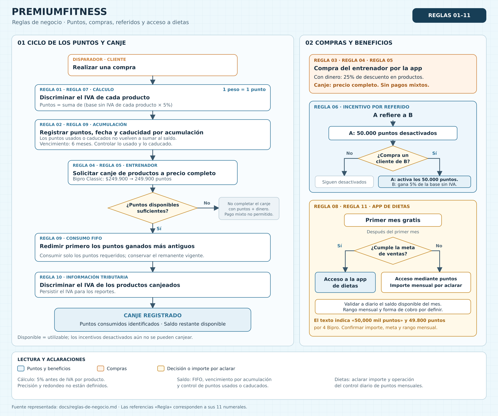

# Reglas de negocio

## Diagrama de flujo

El diagrama resume las 11 reglas de este documento: cálculo y vencimiento de puntos, canje por FIFO, compras del entrenador, incentivo por referido y acceso a dietas. Las referencias «Regla» corresponden a los numerales del listado. El importe de dietas se señala como pendiente de aclarar porque el texto menciona «50,000 mil puntos» y también 49.800 puntos por cuatro Bipro.

[Abrir imagen en tamaño completo](img/reglas-de-negocio.png) · [Versión vectorial editable (SVG)](img/reglas-de-negocio.svg)

> **Diagrama desactualizado (9 nov 2026):** todavía muestra los puntos calculados sin IVA y no incluye las reglas 12 a 15. Prevalece el texto.

## Detalle de las reglas

1. 1 peso equivale a 1 punto. Los puntos de la compra de un cliente son el 5% de **lo que el cliente pagó por los productos, con el descuento aplicado y con IVA incluido**. Se calculan una sola vez sobre el total del pedido, sin incluir el envío, y se redondean al entero más cercano (0,5 sube). Ejemplo: una Bipro de 249.900 con 10% de descuento se paga 224.910 → 224.910 × 5% = 11.245,5 → **11.246 puntos**. El IVA solo se discrimina para calcular la comisión, no los puntos. *(Definido el 9 nov 2026: antes se descontaba el IVA de cada producto.)*

2. Los puntos tiene fecha de expiración, 6 meses por cada acumulacion.

3. El entrenador tiene descuento del 25% si hace compras por la app pero no puede usar pagos mixtos entre puntos y dinero.

4. El entrenador puede canjear los puntos acumulados por productos pero en este caso el producto no tiene descuento.

5. El descuento del entrenador solo aplica si compra productos no aplica para redimir los puntos, para canjear un bipro classic con los puntos el total de puntos que debe tener es del precio full del producto osea 249.900.

6. Los 50 mil puntos que otorga el entrenador referido solo se activan cuando un cliente del entrenador referido haga una compra:

El entrenador A rifiere al entrenador B (entrenador A obtiene 50 mil pero en estado desactivado) el cliente del entrenador B realiza una compra entonces se debloquea los puntos ganados por el entrenador A. El entrenador B gana el 5% del valor de esa compra con IVA incluido.

7. Los puntos ganados por las compras de los clientes se calculan con IVA incluido. La comisión sí se calcula sobre el valor antes de IVA, discriminando el IVA de cada producto. *(Cambio del 9 nov 2026: antes los puntos también se calculaban antes de IVA.)*

8. La app de dietas debe tener un rango de puntos mensuales para su uso, debe validar cada día la disponibilidad de saldo de puntos por mes.

9. Los puntos deben tener un estado para poder saber si ya se usaron y que no vuelvan a sumar, deben tener fecha de caducidad, entonces dos estados, usado, caducado. El sistema debe usar los puntos en sistema fifo, los primeros que ganaron son los que se deben redimir, puede que al redimir puntos por productos queden con saldo de puntos.

10. Cuando el entreador redime sus puntos por productos el sistema debe tener sacar el iva de esos productos y persistirlos para reportes.

11. Si el entrenador cumple su meta de ventas tiene acceso a la app de dietas, en dado caso no cumpla el valor de la app de dietas es de 50,000 mil puntos (primer mes gratis) serian 4 Bipro que equivalen 49,800 puntos.

12. El QR es una forma de presentar el enlace del entrenador: un enlace con su id codificado en base64. El entrenador puede compartirlo por redes sociales, WhatsApp o en QR. El enlace de clientes lleva a la app de clientes, y el enlace para otros entrenadores lleva a la app de entrenadores. Son apps distintas, cada una en su subdominio. El entrenador B solo queda referido por A si se registra desde el enlace (o el QR) de A; no hay un cupón para entrenadores.

13. Cada entrenador tiene un cupón con un nombre único. El cliente queda asociado a un entrenador de dos formas:
    - Entra por el enlace del entrenador. El enlace lo lleva al login; si ya está registrado pasa al dashboard, y si no, se registra. El id del entrenador queda guardado.
    - Se registra sin enlace y luego escribe el cupón del entrenador.
    - Si ya estaba registrado sin entrenador y abre el enlace, queda asociado a ese entrenador al iniciar sesión.

    Un cliente asociado no ve el campo del cupón. Un cliente sin cupón puede comprar a precio completo y su compra no genera recompensas.

14. Cuando el cliente está asociado a un entrenador, todo el catálogo se muestra con el descuento aplicado: un badge con el porcentaje, el precio con descuento y el precio real tachado.

15. Los porcentajes no son fijos. El 10% del cliente, el 25% del entrenador, el 5% en puntos y el 15% de comisión son valores por defecto configurables. Cada producto puede tener una estrategia propia que cambie el descuento con cupón y la comisión. Ejemplo: Nutra Balance tiene un 5% adicional (el cliente recibe 15% de descuento) y la comisión del entrenador baja al 10%.
