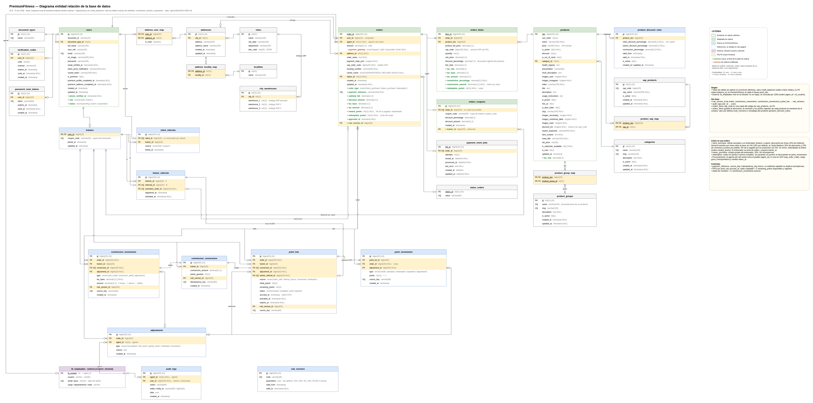

# 01 — Diagrama entidad relación (DER)

**Estado:** propuesta v0.8 lista para revisión · **Creado:** 7 de noviembre de 2026

## Petición original

> Tomando como contexto los archivos docs/fases-de-desarrollo, reglas-de-negocio, requerimientos, mvp-premiumfitness genera un diagrama de draw.io que represente las entidades y relaciones del sistema. Genera una propuesta de DER en formato draw.io y exporta el diagrama a un archivo .drawio. El diagrama debe incluir las entidades, atributos, relaciones y cardinalidades según la información disponible en los documentos mencionados. Añádelo en docs/img.

**Revisión del 7 de noviembre de 2026:** la v0.1 no partía de los repositorios de referencia. Esta versión toma como base el esquema real de `backend-radical-nutrition`, como pide `docs/fases-de-desarrollo.md` §2.1. Entre otros cambios, usa un solo campo `full_name` en lugar de nombres y apellidos separados.

**Revisión v0.3, 7 de noviembre de 2026:** PremiumFitness también se conectará con SAP Business One. Se recuperan de radical `sap_products`, `product_sap_map`, `city_warehouses` (bodegas SAP por ciudad), `orders.sap_order_code`, `orders_items.sap_code` y `products.discount_list`. Se dibujan en una cuarta página.

**Revisión v0.4, 7 de noviembre de 2026:** como radical, PremiumFitness genera el pedido y muestra su trazabilidad, y lo procesa el admin del call center. Cada pedido queda a cargo de un agente (`orders.agent_id`). Los agentes son los empleados de la intranet (`crisenri_intranet.tb_empleados`, tabla externa), con la que también se inicia sesión en el admin. La página 4 pasa a ser «Gestión de pedidos: call center, SAP y envío». Los ajustes y la auditoría registran al agente, y el rol `operator` sale de `users`.

**Revisión v0.5, 7 de noviembre de 2026:** se recuperan de radical `product_groups` y `product_group_map`, que agrupan las presentaciones de un producto, y `orders_coupons`, el cupón aplicado al pedido. El cupón no se usa en el MVP, pero queda preparado para futuras promociones.

**Revisión v0.6, 8 de noviembre de 2026:** las tablas de radical se habían resumido: había columnas agrupadas, columnas omitidas y tipos aproximados. Ahora cada tabla existente o adaptada se genera desde el esquema real de radical (dump SQL más migraciones), con las mismas columnas, en el mismo orden y con los mismos tipos. Las columnas de PremiumFitness van al final, marcadas con `+`. Se recuperan también las columnas que se habían quitado (`users.socket_token`, `is_premium` y `premium_*`, y `orders.balance_id`) y la tabla `credit_balances`. El generador vive en `scripts/der/generar_der.py`.

**Revisión v0.7, 8 de noviembre de 2026:** la base de datos de radical será el punto de partida del desarrollo en Node.js y Express. El DER pasa a ser un solo diagrama de la base: todas las tablas de radical, idénticas a su esquema, salvo `credit_balances` y su FK `orders.balance_id` (el saldo a favor retail lo reemplazan los lotes de puntos), más las tablas y columnas nuevas que resuelven la lógica de negocio. Se eliminan las cuatro páginas por dominio.

**Revisión v0.8, 9 de noviembre de 2026:** el modelo de referidos y descuentos se ajusta a las reglas 12 a 15 de `reglas-de-negocio.md` (spec `specs/negocio/01-enlace-cupon-y-descuentos.md`):

- `trainers.coupon_code` reemplaza a `referral_codes`.
- `client_referrals` tiene un solo entrenador por cliente y guarda el origen del vínculo (enlace o cupón).
- La atribución del pedido pasa a `orders_coupons.trainer_id`, que reemplaza a `orders.attributed_trainer_id`.
- La nueva tabla `product_discount_rules` guarda las excepciones de descuento y comisión por producto.
- `orders_items` registra por línea la comisión y los puntos.
- Los puntos se calculan con IVA incluido.

## Objetivo

Proponer el modelo de datos del MVP comercial para revisarlo con negocio y tecnología antes de la fase 2 (arquitectura). El modelo reutiliza las tablas de radical y añade solo lo que exige PremiumFitness. Debe soportar los recorridos del MVP: referidos por QR, compras con descuento, recompensas por venta, bono A → B, lotes de puntos con FIFO y caducidad, conversión de comisión, canjes y reportes conciliables.

## Fuentes

- `docs/requerimientos.md` (prevalece ante contradicciones).
- `docs/reglas-de-negocio.md`, reglas 1 a 11.
- `docs/MVP-PremiumFitness.md`, escenarios A-01 a A-19.
- `docs/fases-de-desarrollo.md`, §1 y §2.1.
- `docs/PRD-PremiumFitness.md`, §7 y §10, como apoyo.
- **backend-radical-nutrition:**
  - `docs/database/schema/crisenri_radical_nutrition_clear.sql` y las migraciones de `docs/database/migrations/`.
  - `docs/diagram/database/der.drawio` y `order.drawio`, como referencia de estilo.
  - Gestión de pedidos y call center: `src/Features/Admin` (login con `tb_empleados`), `src/Features/Order` (tomar, liberar, código SAP, guía y estado), `src/Features/Carrier` (rastreo de la guía), `src/Features/Reports` (pedidos aprobados por agente) y `docs/md/endpoints.md` §21 Admin.
  - Integración SAP: `docs/md/prd_radical_portal_equipo.md` §6.2, `docs/md/endpoints.md` (§5 SAP Products y §8 City Warehouses), `src/Features/Auth/QrController.php` y `src/Features/Checkout/CheckoutService.php`.
  - `.agents/rules/database-schema.md`.
- **join.nutramerican.com:**
  - `user.model.ts`: el usuario se maneja con `fullName`.
  - `commission-report.model.ts`: reportes de comisiones por día, cupón, producto y ciudad.
  - El registro verifica que el código del cupón esté disponible.
- **gifts.nutramerican.com:** no define modelos de datos propios para el DER. Es referencia de UI de catálogo y compra.

## Alcance

- Tablas, columnas principales, claves, relaciones y cardinalidades del MVP comercial: usuarios, direcciones, referidos, catálogo, pedidos, pagos, envíos, gestión de pedidos por el call center, integración con SAP, comisiones, lotes y movimientos de puntos, conversión, canjes, ajustes, versionado de reglas y auditoría.
- Origen de cada tabla respecto a radical: existente sin cambios, adaptada (con columnas nuevas o modificadas marcadas) o nueva.
- Archivo editable `docs/img/diagrama-entidad-relacion.drawio` con un solo diagrama de la base de datos, y su PNG.
- Resumen de tablas y decisiones en este spec.

## Fuera de alcance

- **App de dietas** (fase 8, RF-15): tendrá su propio spec.
- **`credit_balances` y `orders.balance_id`:** saldo a favor retail de radical; no se llevan a PremiumFitness porque el saldo de recompensas vive en `point_lots`.
- **Columnas de radical sin uso en el MVP:** se conservan para mantener la estructura: `users.is_premium`, `premium_*` y `socket_token`.
- **Motor, índices físicos y migraciones:** fase 2, D-12.
- **Pantallas y permisos del admin del call center:** tendrán su propio spec.
- **Contrato con SAP:** endpoints del Service Layer, middleware, mapeo de campos y reintentos. Se definen en el spec de la integración.
- **Reportes:** se obtienen por consulta sobre `orders`, `orders_items`, `commission_movements`, `point_lots` y `point_movements`. No tienen tablas propias.

## Criterios de aceptación

1. Cada entidad mínima del PRD §10 aparece en el diagrama, salvo dietas, que queda fuera de alcance.
2. Cada tabla indica si existe en radical, si se adapta o si es nueva. Las columnas nuevas o modificadas de las tablas adaptadas están marcadas.
3. Cada relación muestra su cardinalidad con notación pata de gallo.
4. El modelo permite verificar:
   - La atribución del pedido al entrenador por el cupón guardado en el pedido, sin depender del navegador (A-02, A-03).
   - Que las recompensas se acreditan una sola vez por pedido, mediante claves de origen únicas (A-05, A-06).
   - La activación única del bono A → B y el pedido que la causó (A-07, A-08).
   - Lotes con remanente, estado y caducidad, y consumo FIFO trazable por lote (A-11, A-12, A-15).
   - Conversión con débito de comisión y crédito de puntos vinculados (A-14).
   - IVA por línea en pedidos y canjes (A-03, A-09, A-10).
   - Ajustes ligados a la operación original sin borrar movimientos (A-16).
   - Reportes por período, entrenador y ciudad (A-17).
   - La trazabilidad con SAP: artículo SAP por línea, pedido SAP por orden, bodegas por ciudad y cliente por documento.
   - El agente que procesa cada pedido y el que registra cada ajuste.
5. El `.drawio` abre en draw.io y cada página se exporta a PNG.
6. Los supuestos están clasificados como Confirmado, Derivado o Pendiente.

## Supuestos y decisiones

| ID | Supuesto o decisión | Clase | Fuente |
| --- | --- | --- | --- |
| S-01 | Las tablas de radical se copian exactamente de su esquema (columnas, orden, tipos, nulabilidad, PK, UQ, FK y autoincremento), incluidas sus migraciones. Las tablas nuevas usan las mismas convenciones de tipos (`bigint(20)`, `int(11)`, `decimal(12,2)`, `bit(1)`, `enum`, `timestamp`). | Confirmado | Fases §2.1. El motor sigue pendiente (D-12); MySQL o MariaDB son compatibles con estos tipos. |
| S-02 | Los nombres de tablas y columnas están en inglés y `snake_case`, como en radical. | Derivado | Esquema de radical. Coincide con las carpetas de `codebase-standards.md`. |
| S-03 | El nombre del usuario es un solo campo, `full_name`. No hay nombres y apellidos separados. | Confirmado | Radical `users.full_name`; join `fullName`. |
| S-04 | `users` conserva todas las columnas de radical y añade al final `phone_verified_at`, `role` y `status`. | Derivado | Radical, más la verificación SMS del MVP. |
| S-05 | Cada usuario tiene un solo rol: `client` o `trainer`. Los operadores no son usuarios del portal: son agentes de la intranet (S-31). | Derivado | D-05: falta decidir si un usuario puede tener varios roles. |
| S-06 | `num_cell` no es único en radical. Si el login o la recuperación por SMS usan el teléfono, debe pasar a ser único. | Pendiente | Revisión de `sms-account-verification` y de radical. |
| S-07 | Las direcciones se reutilizan tal cual: `addresses`, `address_user_map` (con `is_main`), `cities` (código DANE) y `localities`. | Confirmado | Radical. Permite el reporte por ciudad de join. |
| S-08 | `trainers` es un subtipo 1:0..1 de `users`. Así, las FK de referidos y recompensas solo pueden apuntar a entrenadores. | Derivado | Decisión de diseño. |
| S-09 | Cada entrenador tiene un cupón único (`trainers.coupon_code`). Sus dos enlaces (app de clientes y app de entrenadores) llevan su id en base64, y el QR muestra el mismo enlace. | Confirmado | Reglas 12 y 13; confirmación del 9 nov 2026. |
| S-10 | El navegador solo guarda el id del enlace hasta el registro o login. El vínculo persistente vive en `client_referrals`, y cada pedido guarda el cupón y el entrenador en `orders_coupons`. | Confirmado | Regla 13. |
| S-11 | Un cliente tiene un solo entrenador (`client_referrals.client_id` único) y no lo cambia por sí mismo. `source` indica si llegó por enlace o por cupón. | Confirmado | Regla 13; RN-20. |
| S-12 | Un entrenador B tiene como máximo un referente A (`trainer_referrals.referred_id` único). | Derivado | PRD §6.4. |
| S-13 | Compras de cliente, compras del entrenador y canjes usan la misma tabla `orders`, con `order_type`. El canje reutiliza el seguimiento de radical: estado, guía y transportadora. | Derivado | Radical guarda el envío en `orders`. Evita una tabla de envíos aparte. |
| S-14 | El pago se persiste como en radical: `payment_gateway`, `payment_state_json` y `payment_event_jobs`. Se añade `payment_reference` única para la idempotencia. `payment_gateway` pasa a ser anulable para los canjes. | Derivado | Radical; D-10. Si hay que conservar cada intento de pago, se añadiría una tabla `payment_transactions`. |
| S-15 | `products.price` es un entero con IVA incluido, como en radical. Se añade `tax_rate` por producto, y cada línea copia la tasa, la base y el IVA. | Confirmado | Radical; PRD §7.2; regla 10. |
| S-16 | Los puntos son enteros (1 peso = 1 punto) y los importes son `decimal(12,2)`, como en radical. | Pendiente | Regla 1. El redondeo depende de D-03. |
| S-17 | La comisión es un libro de movimientos (`commission_movements`). El saldo convertible es la suma de esos movimientos. | Derivado | PRD §10. |
| S-18 | Cada acumulación crea un lote en `point_lots`. El diseño sigue la idea de `credit_balances` de radical (monto, vencimiento y aplicación) y añade remanente y estados. | Confirmado | PRD §7.3; regla 9. |
| S-19 | `point_lots.expires_at` es anulable para el bono inactivo hasta definir desde cuándo cuenta su vigencia. | Pendiente | D-06. |
| S-20 | La conversión guarda la versión de regla aplicada. El cálculo exacto del 50% no se fija en el modelo. | Pendiente | D-04. |
| S-21 | Los orígenes de un lote o movimiento son FK explícitas anulables, no un par genérico `source_type` + `source_id`. | Derivado | Decisión de diseño: integridad referencial en base de datos. |
| S-22 | La compra propia del entrenador (`order_type = trainer_purchase`) no genera recompensas. | Confirmado | PRD §6.6; MVP §3.3. |
| S-23 | El beneficiario del 15% es el entrenador. | Pendiente | PD-01: requerimientos dice «el cliente recibe el 15%» en un punto y «el entrenador» en otro. |
| S-24 | PremiumFitness se integra con SAP Business One. Se reutilizan `sap_products`, `product_sap_map`, `city_warehouses`, `orders.sap_order_code`, `orders_items.sap_code` y `products.discount_list` tal como están en radical. | Confirmado | Indicación del usuario (7 nov 2026). `docs/requerimientos.md` no menciona SAP; no hay contradicción, pero conviene registrarlo en el PRD. |
| S-25 | `city_warehouses` asigna a cada ciudad tres bodegas SAP en orden de prioridad para despachar. | Confirmado | Indicación del usuario; radical `city_warehouses`. |
| S-26 | `orders_items.sap_code` es una copia del código del artículo SAP, sin FK, para conservar el histórico si cambia el maestro. | Derivado | Radical lo modela así. |
| S-27 | Como en radical, el agente crea el pedido en SAP y registra `sap_order_code`, `tracking_number` y `carrier_name` desde el admin. Si más adelante el pedido se envía a SAP de forma automática, se añadiría una tabla de jobs similar a `payment_event_jobs`. | Confirmado | Indicación del usuario; radical `PATCH /api/admin/orders/{id}/sap-order-code/by-agent` y `/tracking-number`. |
| S-28 | `users.document_type_id` + `document_id` identifican al cliente (socio de negocio) en SAP, como en el login por QR de radical. Falta definir si los entrenadores y clientes de PremiumFitness se crean primero en SAP o en el portal. | Pendiente | Radical `QrController`. |
| S-29 | Falta definir si los canjes (`order_type = redemption`) también se registran en SAP y con qué documento. | Pendiente | D-02. |
| S-31 | Los agentes del call center son los empleados de `crisenri_intranet.tb_empleados`. Esa tabla es externa: no se migra, se consulta por JOIN con `orders.agent_id = tb_empleados.id_usuario`, y el admin inicia sesión con ella. | Confirmado | Indicación del usuario; radical `EmpleadoRepository` y `AdminAuthController`. Falta confirmar que PremiumFitness usa la misma intranet. |
| S-32 | El agente toma un pedido sin asignar y solo puede liberarlo si es suyo y todavía no tiene `sap_order_code`. | Confirmado | Radical `takeByAgent` y `releaseByAgent`. |
| S-33 | La trazabilidad que ve el cliente usa `status_orders` (los mismos estados de radical), la guía y la transportadora, consultada en la API de la transportadora. No se guarda un historial de cambios de estado. Si negocio lo pide, se añadiría `order_status_history`. | Derivado | Radical `CarrierController` y `ServientregaTrackingService`. |
| S-34 | `adjustments.agent_id` y `audit_logs.agent_id` registran al agente que hizo la operación. `audit_logs.user_id` registra las acciones del cliente o del entrenador. | Derivado | Decisión de diseño a partir de S-31. |
| S-35 | `docs/casos-de-uso-y-actores.md` ya incluye al agente del call center (ACT-03) y los casos de uso CU-16 a CU-19 de procesamiento, envío y seguimiento del pedido. | Confirmado | Spec `specs/documentacion/01-casos-de-uso-pedidos-y-envios.md`. |
| S-36 | `product_groups` y `product_group_map` se reutilizan tal cual: agrupan las presentaciones de un mismo producto (por ejemplo, 225 g y 900 g) en una relación N:M. | Confirmado | Indicación del usuario; radical. |
| S-37 | `orders_coupons` se reutiliza de radical y se le añade `trainer_id`; guarda el cupón del entrenador en cada pedido de un cliente asociado. Antes decía: se reutiliza tal cual: un cupón por pedido (`order_id` único), con código, porcentaje y monto; el mismo código puede repetirse en muchos pedidos. El descuento se reparte en `orders_items.discount_percentage`. No se usa en el MVP. | Derivado | Radical, checkout retail. Para promociones reales faltaría un maestro `coupons` (vigencia, límites y a quién aplica), y definir si el cupón se combina con el 10% o el 25% y si reduce la base de puntos y comisión (PD-12). |
| S-38 | Los porcentajes por defecto viven en `rule_versions.parameters`. `product_discount_rules` define excepciones por producto con vigencia: descuento con cupón, descuento del entrenador y comisión (NULL = valor por defecto). Al comprar, cada línea copia los porcentajes vigentes. | Confirmado; descuento del entrenador por producto derivado | Regla 15. |
| S-39 | Comisión por línea: `commission_amount = tax_base × commission_percentage`; `commission_movements.amount` suma las líneas. Puntos por pedido: `orders.reward_points = round(Σ line_total de productos × porcentaje de puntos)`, al entero más cercano y sin el envío. | Confirmado | Reglas 1 y 7 (9 nov 2026). |
| S-30 | `products.discount_list` (tramos por cantidad con su `sap_code`) se conserva por la integración, aunque los descuentos de PremiumFitness (10% y 25%) dependen del rol y no de la cantidad. | Derivado | Radical. Falta confirmar si los tramos aplican. |

## Plan

1. Leer el esquema real de radical (SQL y migraciones), su DER y los modelos de join y gifts.
2. Clasificar cada tabla de radical: se reutiliza, se adapta o queda fuera del MVP.
3. Añadir solo las tablas nuevas que exigen las reglas: referidos, comisiones, lotes, movimientos, ajustes, versiones de regla y auditoría.
4. Generar el `.drawio` con `scripts/der/generar_der.py`, que lee el esquema de radical y lo dibuja con el estilo de sus DER, en un solo diagrama de la base. La tabla externa de agentes se dibuja en morado.
5. Exportar el diagrama a PNG y revisar legibilidad y cruces.

La FK `rule_version_id` se documenta en una nota del diagrama y no se dibuja desde todas las tablas que la usan.

## Modelo propuesto

Diagrama editable: [diagrama-entidad-relacion.drawio](../../docs/img/diagrama-entidad-relacion.drawio).

### Tablas

| Bloque | Tabla | Origen | Responsabilidad |
| --- | --- | --- | --- |
| Identidad y referidos | `users` | Adaptada | Identidad con `full_name`, documento, celular, email y contraseña. Añade verificación del teléfono, rol y estado. |
| Identidad y referidos | `document_types` | Existente | Tipos de documento. |
| Identidad y referidos | `verification_codes` | Existente | Códigos de verificación por email o SMS. |
| Identidad y referidos | `password_reset_tokens` | Existente | Recuperación de contraseña. |
| Identidad y referidos | `addresses`, `address_user_map` | Existente | Direcciones del usuario, con la principal marcada. |
| Identidad y referidos | `cities`, `localities`, `address_locality_map` | Existente | Ciudad con código DANE y localidad opcional. |
| Identidad y referidos | `trainers` | Nueva | Subtipo de `users` para el entrenador, con su cupón único. |
| Identidad y referidos | `client_referrals` | Nueva | Único entrenador del cliente y origen del vínculo (enlace o cupón). |
| Identidad y referidos | `trainer_referrals` | Nueva | Relación A → B y pedido que activó el bono. |
| Pedidos y catálogo | `products` | Adaptada | Añade `tax_rate`. El precio ya incluye IVA. Conserva `discount_list` con los códigos SAP por tramo. |
| Pedidos y catálogo | `categories` | Existente | Categorías del catálogo. |
| Pedidos y catálogo | `product_groups`, `product_group_map` | Existente | Grupos de presentaciones de un mismo producto. |
| Pedidos y catálogo | `orders_coupons` | Adaptada | Cupón y entrenador de cada pedido de un cliente asociado. Es la atribución de la venta. |
| Pedidos y catálogo | `product_discount_rules` | Nueva | Estrategias por producto: descuento con cupón, descuento del entrenador y comisión, con vigencia. |
| Pedidos y catálogo | `orders` | Adaptada | Conserva `agent_id` y `sap_order_code`. Añade tipo de pedido, totales de descuento e IVA, puntos ganados por el pedido (`reward_points`), puntos del canje, referencia de pago y versión de regla. El entrenador se toma de `orders_coupons`. |
| Pedidos y catálogo | `orders_items` | Adaptada | Conserva `sap_code`. Usa `discount_percentage` para el descuento vigente del producto. Añade tasa, base e IVA; porcentaje y monto de comisión, y puntos del canje. |
| Pedidos y catálogo | `status_orders` | Existente | Estados del pedido. |
| Pedidos y catálogo | `payment_event_jobs` | Existente | Reintento de webhooks que llegan antes que el pedido. |
| Recompensas y operación | `commission_movements` | Nueva | Abono de comisión del pedido (suma de líneas), débitos por conversión y ajustes. |
| Recompensas y operación | `commission_conversions` | Nueva | Conversión del total de comisión a puntos. |
| Recompensas y operación | `point_lots` | Nueva | Lote con cantidad inicial, remanente, estado, fecha de acumulación y caducidad. |
| Recompensas y operación | `point_movements` | Nueva | Abono, activación, consumo FIFO, caducidad y ajuste por lote. |
| Recompensas y operación | `adjustments` | Nueva | Cancelaciones, devoluciones y restituciones ligadas al pedido original y al agente que las registra. |
| Recompensas y operación | `rule_versions` | Nueva | Parámetros vigentes: porcentajes, bono, vigencia y fórmula de conversión. |
| Recompensas y operación | `audit_logs` | Nueva | Agente o usuario, acción, entidad y datos de cada operación sensible. |
| SAP y bodegas | `sap_products` | Existente | Maestro de artículos SAP (`sap_code` único). |
| SAP y bodegas | `product_sap_map` | Existente | Relación N:M entre producto web y artículos SAP. |
| SAP y bodegas | `city_warehouses` | Existente | Tres bodegas SAP por ciudad, en orden de prioridad. |
| Call center | `tb_empleados` | Externa | Agentes del call center en la intranet (`crisenri_intranet`). No se migra. |

### Controles de integridad

- **Idempotencia:** son únicos `orders.payment_reference`, `commission_movements.source_key`, `point_lots.source_key`, `point_movements.source_key` y `commission_conversions.idempotency_key`. El dispatcher de radical ya trata como no-op un pedido aprobado.
- **Bono único:** `trainer_referrals.referred_id`, `trainer_referrals.activation_order_id` y `point_lots.trainer_referral_id` son únicos.
- **Conversión única:** `commission_movements.conversion_id` y `point_lots.conversion_id` son únicos. Cada conversión tiene un débito y un crédito.
- **FIFO:** el consumo sigue `point_lots.accrued_at` con desempate por `id` (PRD §7.3). El saldo canjeable es la suma de `remaining_points` de los lotes `available` no caducados.
- **Asignación del agente:** `orders.agent_id` solo se asigna si está vacío, y se libera solo si el pedido es del agente y no tiene `sap_order_code`.
- **Canje:** `orders.order_type = redemption`, sin pasarela, con `points_total` igual a la suma de `orders_items.points`.

## Checklist

- [x] Reescribir el spec con objetivo, alcance, criterios y supuestos
- [x] Definir entidades, atributos y claves por módulo (v0.1)
- [x] Definir relaciones y cardinalidades (v0.1)
- [x] Generar `docs/img/diagrama-entidad-relacion.drawio` (v0.1)
- [x] Exportar el PNG del diagrama (v0.1)
- [~] Exportar SVG: descartado por tamaño (unos 4 MB); el `.drawio` es la fuente vectorial
- [x] Revisar el render de v0.1
- [x] Revisar el esquema SQL, las migraciones y el DER de backend-radical-nutrition
- [x] Revisar los modelos de datos de join.nutramerican.com y gifts.nutramerican.com
- [x] Clasificar cada tabla de radical como existente, adaptada o fuera del MVP
- [x] Rehacer el modelo sobre radical: `full_name`, direcciones, pedidos con pago y envío, nombres en inglés
- [x] Regenerar el `.drawio` en tres páginas con el estilo de los DER de radical
- [x] Exportar un PNG por página y revisar legibilidad y cruces
- [x] Recuperar de radical las tablas y columnas de SAP y dibujar la página 4 (v0.3)
- [x] Exportar el PNG de la página 4 y regenerar los de las páginas 1 a 3
- [x] Revisar en radical el admin del call center: agentes, gestión del pedido y trazabilidad
- [x] Añadir `orders.agent_id` y la tabla externa `tb_empleados`, y ligar ajustes y auditoría al agente (v0.4)
- [x] Rehacer la página 4 como gestión de pedidos (call center, SAP y envío) y regenerar los PNG
- [x] Actualizar `docs/casos-de-uso-y-actores.md` con el actor agente del call center (S-35)
- [x] Añadir `product_groups`, `product_group_map` y `orders_coupons` en la página 2 (v0.5)
- [x] Generar las tablas de radical desde su esquema real (columnas, orden y tipos exactos) con `scripts/der/generar_der.py` (v0.6)
- [x] Unificar el DER en un solo diagrama de la base: radical sin `credit_balances` más las tablas nuevas (v0.7)
- [x] Ajustar referidos, cupón, descuentos por producto y puntos con IVA (v0.8)
- [ ] Revisión y aprobación del modelo por negocio y tecnología
