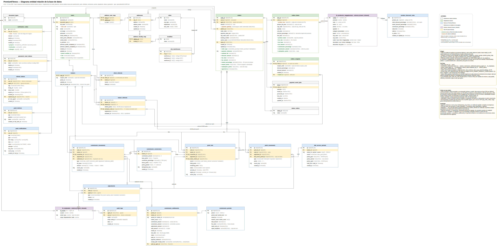

# 01 — Diagrama entidad relación (DER)

**Estado:** propuesta v0.19 lista para revisión · **Creado:** 7 de noviembre de 2026

## Petición original

> Tomando como contexto los archivos docs/fases-de-desarrollo, reglas-de-negocio, requerimientos, mvp-premiumfitness genera un diagrama de draw.io que represente las entidades y relaciones del sistema. Genera una propuesta de DER en formato draw.io y exporta el diagrama a un archivo .drawio. El diagrama debe incluir las entidades, atributos, relaciones y cardinalidades según la información disponible en los documentos mencionados. Añádelo en docs/img.

**Revisión del 7 de noviembre de 2026:** la v0.1 no partía de los repositorios de referencia. Esta versión toma como base el esquema real de `backend-radical-nutrition`, como pide `docs/fases-de-desarrollo.md` §2.1. Entre otros cambios, usa un solo campo `full_name` en lugar de nombres y apellidos separados.

**Revisión v0.3, 7 de noviembre de 2026:** PremiumFitness también se conectará con SAP Business One. Se recuperan de radical `sap_products`, `product_sap_map`, `city_warehouses` (bodegas SAP por ciudad), `orders.sap_order_code`, `orders_items.sap_code` y `products.discount_list`. Se dibujan en una cuarta página.

**Revisión v0.4, 7 de noviembre de 2026:** como radical, PremiumFitness genera el pedido y muestra su trazabilidad, y lo procesa el admin del call center. Cada pedido queda a cargo de un agente (`orders.agent_id`). Los agentes son los empleados de la intranet (`crisenri_intranet.tb_empleados`, tabla externa), con la que también se inicia sesión en el admin. La página 4 pasa a ser «Gestión de pedidos: call center, SAP y envío». Los ajustes y la auditoría registran al agente, y el rol `operator` sale de `users`.

**Revisión v0.5, 7 de noviembre de 2026:** se recuperan de radical `product_groups` y `product_group_map`, que agrupan las presentaciones de un producto, y `orders_coupons`, el cupón aplicado al pedido. El cupón no se usa en el MVP, pero queda preparado para futuras promociones.

**Revisión v0.6, 8 de noviembre de 2026:** las tablas de radical se habían resumido: había columnas agrupadas, columnas omitidas y tipos aproximados. Ahora cada tabla existente o adaptada se genera desde el esquema real de radical (dump SQL más migraciones), con las mismas columnas, en el mismo orden y con los mismos tipos. Las columnas de PremiumFitness van al final, marcadas con `+`. Se recuperan también las columnas que se habían quitado (`users.socket_token`, `is_premium` y `premium_*`, y `orders.balance_id`) y la tabla `credit_balances`. El generador vive en `scripts/der/generar_der.py`.

**Revisión v0.7, 8 de noviembre de 2026:** la base de datos de radical será el punto de partida del desarrollo (entonces se pensaba en Node.js y Express; desde el 9 nov 2026 el proyecto es un fork de radical en PHP, spec `arquitectura/01`). El DER pasa a ser un solo diagrama de la base: todas las tablas de radical, idénticas a su esquema, salvo `credit_balances` y su FK `orders.balance_id` (el saldo a favor retail lo reemplazan los lotes de puntos), más las tablas y columnas nuevas que resuelven la lógica de negocio. Se eliminan las cuatro páginas por dominio.

**Revisión v0.8, 9 de noviembre de 2026:** el modelo de referidos y descuentos se ajusta a las reglas 12 a 15 de `reglas-de-negocio.md` (spec `specs/negocio/01-enlace-cupon-y-descuentos.md`):

- `trainers.coupon_code` reemplaza a `referral_codes`.
- `client_referrals` tiene un solo entrenador por cliente y guarda el origen del vínculo (enlace o cupón).
- La atribución del pedido pasa a `orders_coupons.trainer_id`, que reemplaza a `orders.attributed_trainer_id`.
- La nueva tabla `product_discount_rules` guarda las excepciones de descuento y comisión por producto.
- `orders_items` registra por línea la comisión y los puntos.
- Los puntos se calculan con IVA incluido.

**Revisión v0.9, 9 de noviembre de 2026:** cambios del spec `specs/negocio/02-puntos-por-referido-y-constantes.md`.

- **Constantes:** las constantes del negocio pasan a variables de entorno. Se elimina `rule_versions` junto con todas las FK `rule_version_id`. Cada registro guarda el valor que aplicó: `orders.reward_percentage`, `trainer_referrals.referral_points` y `commission_conversions.conversion_percentage`.
- **Puntos por referido:** los 50.000 puntos pendientes viven en `trainer_referrals`. El lote de A se crea solo al activarse, con la primera compra aprobada de un cliente de B.
- **Estados:** se eliminan el estado `inactive` de `point_lots` y el tipo `activation` de `point_movements`.
- **Puntos por pedido:** los puntos se calculan por pedido (`orders.reward_points`), no por línea.

**Revisión v0.10, 9 de noviembre de 2026:** la comisión no convertida se paga en dinero al final de cada mes, y la conversión tiene fórmula definida (spec `specs/negocio/04-comision-pago-mensual-y-conversion.md`).

- **Liquidación mensual:** nueva tabla `commission_settlements`. `commission_movements` añade `settlement_id` y el tipo `settlement_debit`.
- **Conversión:** `commission_conversions` añade `base_points` y `bonus_points`.

**Revisión v0.11, 9 de noviembre de 2026:** se toma de api-comisiones la cabecera del período (spec `specs/negocio/05-reportes-y-conciliacion-mensual.md`). Nueva tabla `commission_periods`; `commission_settlements` pasa a referenciarla (`period_id`) y añade `orders_count`.

**Revisión v0.12, 9 de noviembre de 2026:** autenticación (spec `specs/seguridad/01-autenticacion-y-sesiones.md`).

- **Login:** `users.num_cell` pasa a ser único, porque es el usuario del login.
- **Códigos SMS:** `verification_codes` guarda el hash del código y añade `purpose`, `destination` y `attempts`.
- **Sesiones:** nueva tabla `refresh_tokens`, con rotación por familia y una sesión por app.
- **Pagos:** `commission_settlements` ya no registra el pago (revertido en v0.14).

**Revisión v0.14, 10 de noviembre de 2026:** se vuelve a registrar el pago de cada liquidación (spec `negocio/04`, regla 10). `commission_settlements` añade `status`, `paid_at`, `payment_reference`, el comprobante (`receipt_path`, `receipt_mime`) y `paid_by_agent_id`. También `due_date`: el día de pago calculado al cierre (el 4 o el siguiente día hábil, según `COMMISSION_PAYMENT_DAY`, `COMMISSION_PAYMENT_SHIFT` y `NON_BUSINESS_DAYS`).

**Revisión v0.13, 9 de noviembre de 2026:** notificaciones push y acceso a dietas (specs `integraciones/01` e `integraciones/02`).

- **Push:** nuevas tablas `push_devices` y `push_notifications` (outbox).
- **Dietas:** nueva tabla `diet_access_periods`, columna `trainers.diet_first_access_at`, columna `point_movements.diet_access_period_id`, y `refresh_tokens.app` añade `diets`.
- **Una sola app web** (spec `arquitectura/02`): los enums `app` pasan a `web`, `admin` y `diets` en `refresh_tokens`, y a `web` y `diets` en `push_devices` y `push_notifications`.

**Revisión v0.15, 15 de noviembre de 2026:** el catálogo sale de la tabla de productos de la intranet (spec `specs/catalogo/01-catalogo-desde-la-intranet.md`).

- **Catálogo externo:** `crisenri_intranet.tb_productos_megaplexstars`, el maestro de la web, se lee sin migrarla, como `tb_empleados`. Salen del modelo `products`, `categories`, `product_groups`, `product_group_map`, `sap_products` y `product_sap_map` de radical: la tabla de la intranet ya trae `category`, `grupo`, `sap_code` y `sap_name`.
- **Sin FK al catálogo:** `orders_items.product_sku` y `product_discount_rules.product_sku` guardan el `codigo` de la intranet, sin FK. `orders_items` añade `product_name` y copia al comprar el nombre, el precio y el `sap_code`.
- **IVA:** ya no hay tasa por producto. Cada línea toma `VAT_PERCENTAGE` (19), salvo los códigos de `VAT_EXEMPT_PRODUCT_CODES` (Nutra C, código 103040), y guarda tasa, base e IVA.
- **Tipos:** la tabla externa se dibuja con los tipos reales (`SHOW COLUMNS`, 15 nov 2026).

**Revisión v0.19, 24 de noviembre de 2026:** los pagos vuelven al diseño de radical: un pedido = un pago. Se **elimina `payment_attempts`** (v0.17 y v0.18) y se añade `orders.payment_code` (`varchar(30)`, única, comparada exacta): el id de pago que recibe la pasarela, `pf-<order_id>`. El prefijo evita que choque con los pedidos de otros proyectos que comparten las cuentas de las pasarelas. Lo que manda la pasarela queda en el pedido (`payment_state_json`), como en radical (spec `backend/03`, P-24).

**Revisión v0.18, 24 de noviembre de 2026:** `payment_attempts` guarda lo que reportó la pasarela en su webhook: `status`, `transaction_id`, `payment_method`, `paid_amount` y `notified_at`. Con ellos la página de respuesta muestra el resultado consultando el id de pago (spec `integraciones/03`).

**Revisión v0.17, 16 de noviembre de 2026:** cada intento de pago tiene su propio id. Se añade `payment_attempts`: su `id` da la referencia `pf-<id>` que recibe la pasarela (spec `backend/03`, P-24; S-49).

**Revisión v0.16, 15 de noviembre de 2026:** la app de dietas es Nutrition & Fitness Plus, con su propio login y backend, desacoplada de PremiumFitness. Su backend consulta a PremiumFitness por el documento del entrenador, con una credencial de servicio (spec `integraciones/02`, revisado).

- **Sin app `diets`:** `refresh_tokens.app` queda en `web` y `admin`; `push_devices.app` y `push_notifications.app` quedan solo en `web`.
- **Sin cambios en el modelo de acceso:** siguen `trainers.diet_first_access_at` (lo fija la primera consulta), `diet_access_periods` y `point_movements.diet_access_period_id`.

## Objetivo

Proponer el modelo de datos del MVP comercial para revisarlo con negocio y tecnología antes de la fase 2 (arquitectura). El modelo reutiliza las tablas de radical y añade solo lo que exige PremiumFitness. Debe soportar los recorridos del MVP: referidos por QR, compras con descuento, recompensas por venta, 50.000 puntos por referido A → B, lotes de puntos con FIFO y caducidad, conversión de comisión, canjes y reportes conciliables.

## Fuentes

- `docs/requerimientos.md` (prevalece ante contradicciones).
- `docs/reglas-de-negocio.md`, reglas 1 a 11.
- `docs/MVP-PremiumFitness.md`, escenarios A-01 a A-19.
- `docs/fases-de-desarrollo.md`, §1 y §2.1.
- `docs/PRD-PremiumFitness.md`, §7 y §10, como apoyo.
- **backend-radical-nutrition:**
  - `docs/database/schema/crisenri_radical_nutrition_clear.sql` y las migraciones de `docs/database/migrations/`.
  - `docs/diagram/database/der.drawio` y `order.drawio`, como referencia de estilo.
  - Gestión de pedidos y call center: `src/Features/Admin` (login con `tb_empleados`), `src/Features/Order` (tomar, liberar, código SAP, guía y estado), `src/Features/Carrier` (rastreo de la guía), `src/Features/Reports` (pedidos aprobados por agente) y `docs/md/endpoints.md` §21 Admin.
  - Integración SAP: `docs/md/prd_radical_portal_equipo.md` §6.2, `docs/md/endpoints.md` (§5 SAP Products y §8 City Warehouses), `src/Features/Auth/QrController.php` y `src/Features/Checkout/CheckoutService.php`.
  - `.agents/rules/database-schema.md`.
- **Catálogo de la intranet:** `crisenri_intranet.tb_productos_megaplexstars`, según el código que la lee hoy: `nutramerican.com` (Node, `productos/index.js`), `melonn` (`ProductDAO.js` y `nutramericanType.js`) y la skill `ficha-producto`.
- **join.nutramerican.com:**
  - `user.model.ts`: el usuario se maneja con `fullName`.
  - `commission-report.model.ts`: reportes de comisiones por día, cupón, producto y ciudad.
  - El registro verifica que el código del cupón esté disponible.
- **gifts.nutramerican.com:** no define modelos de datos propios para el DER. Es referencia de UI de catálogo y compra.

## Alcance

- Tablas, columnas principales, claves, relaciones y cardinalidades del MVP comercial: usuarios, direcciones, referidos, catálogo, pedidos, pagos, envíos, gestión de pedidos por el call center, integración con SAP, comisiones, lotes y movimientos de puntos, conversión, canjes, ajustes, versionado de reglas y auditoría.
- Origen de cada tabla respecto a radical: existente sin cambios, adaptada (con columnas nuevas o modificadas marcadas) o nueva.
- Archivo editable `docs/img/diagrama-entidad-relacion.drawio` con un solo diagrama de la base de datos, y su PNG.
- Resumen de tablas y decisiones en este spec.

## Fuera de alcance

- **App de dietas** (fase 8, RF-15): tendrá su propio spec.
- **`credit_balances` y `orders.balance_id`:** saldo a favor retail de radical; no se llevan a PremiumFitness porque el saldo de recompensas vive en `point_lots`.
- **Columnas de radical sin uso en el MVP:** se conservan para mantener la estructura: `users.is_premium`, `premium_*` y `socket_token`.
- **Motor, índices físicos y migraciones:** fase 2, D-12.
- **Pantallas y permisos del admin del call center:** tendrán su propio spec.
- **Contrato con SAP:** endpoints del Service Layer, middleware, mapeo de campos y reintentos. Se definen en el spec de la integración.
- **Reportes:** se obtienen por consulta sobre `orders`, `orders_items`, `commission_movements`, `point_lots` y `point_movements`. No tienen tablas propias.

## Criterios de aceptación

1. Cada entidad mínima del PRD §10 aparece en el diagrama, salvo dietas, que queda fuera de alcance.
2. Cada tabla indica si existe en radical, si se adapta o si es nueva. Las columnas nuevas o modificadas de las tablas adaptadas están marcadas.
3. Cada relación muestra su cardinalidad con notación pata de gallo.
4. El modelo permite verificar:
   - La atribución del pedido al entrenador por el cupón guardado en el pedido, sin depender del navegador (A-02, A-03).
   - Que las recompensas se acreditan una sola vez por pedido, mediante claves de origen únicas (A-05, A-06).
   - La activación única de los 50.000 puntos por referido A → B y el pedido que la causó (A-07, A-08).
   - Lotes con remanente, estado y caducidad, y consumo FIFO trazable por lote (A-11, A-12, A-15).
   - Conversión con débito de comisión y crédito de puntos vinculados (A-14).
   - IVA por línea en pedidos y canjes (A-03, A-09, A-10).
   - Ajustes ligados a la operación original sin borrar movimientos (A-16).
   - Reportes por período, entrenador y ciudad (A-17).
   - La trazabilidad con SAP: artículo SAP por línea, pedido SAP por orden, bodegas por ciudad y cliente por documento.
   - El agente que procesa cada pedido y el que registra cada ajuste.
5. El `.drawio` abre en draw.io y cada página se exporta a PNG.
6. Los supuestos están clasificados como Confirmado, Derivado o Pendiente.

## Supuestos y decisiones

| ID | Supuesto o decisión | Clase | Fuente |
| --- | --- | --- | --- |
| S-01 | Las tablas de radical se copian exactamente de su esquema (columnas, orden, tipos, nulabilidad, PK, UQ, FK y autoincremento), incluidas sus migraciones. Las tablas nuevas usan las mismas convenciones de tipos (`bigint(20)`, `int(11)`, `decimal(12,2)`, `bit(1)`, `enum`, `timestamp`). | Confirmado | Fases §2.1. El motor sigue pendiente (D-12); MySQL o MariaDB son compatibles con estos tipos. |
| S-02 | Los nombres de tablas y columnas están en inglés y `snake_case`, como en radical. | Derivado | Esquema de radical. Coincide con las carpetas de `codebase-standards.md`. |
| S-03 | El nombre del usuario es un solo campo, `full_name`. No hay nombres y apellidos separados. | Confirmado | Radical `users.full_name`; join `fullName`. |
| S-04 | `users` conserva todas las columnas de radical y añade al final `phone_verified_at`, `role` y `status`. | Derivado | Radical, más la verificación SMS del MVP. |
| S-05 | Cada usuario tiene un solo rol: `client` o `trainer`. Los operadores no son usuarios del portal: son agentes de la intranet (S-31). | Confirmado (9 nov 2026) | Spec `seguridad/01`. |
| S-06 | `users.num_cell` pasa a ser único: es el usuario del login. | Confirmado (9 nov 2026) | Spec `seguridad/01`. |
| S-07 | Las direcciones se reutilizan tal cual: `addresses`, `address_user_map` (con `is_main`), `cities` (código DANE) y `localities`. | Confirmado | Radical. Permite el reporte por ciudad de join. |
| S-08 | `trainers` es un subtipo 1:0..1 de `users`. Así, las FK de referidos y recompensas solo pueden apuntar a entrenadores. | Derivado | Decisión de diseño. |
| S-09 | Cada entrenador tiene un cupón único (`trainers.coupon_code`). Sus dos enlaces de la app web (`/r/c/<id>` para clientes y `/r/t/<id>` para entrenadores; spec `arquitectura/02`) llevan su id en base64, y el QR muestra el mismo enlace. | Confirmado | Reglas 12 y 13; confirmación del 9 nov 2026. |
| S-10 | El navegador solo guarda el id del enlace hasta el registro o login. El vínculo persistente vive en `client_referrals`, y cada pedido guarda el cupón y el entrenador en `orders_coupons`. | Confirmado | Regla 13. |
| S-11 | Un cliente tiene un solo entrenador (`client_referrals.client_id` único) y no lo cambia por sí mismo. `source` indica si llegó por enlace o por cupón. | Confirmado | Regla 13; RN-20. |
| S-12 | Un entrenador B tiene como máximo un referente A (`trainer_referrals.referred_id` único). | Derivado | PRD §6.4. |
| S-13 | Compras de cliente, compras del entrenador y canjes usan la misma tabla `orders`, con `order_type`. El canje reutiliza el seguimiento de radical: estado, guía y transportadora. | Derivado | Radical guarda el envío en `orders`. Evita una tabla de envíos aparte. |
| S-14 | El pago se persiste como en radical: `payment_gateway`, `payment_state_json` y `payment_event_jobs`. Se añade `payment_reference` única para la idempotencia. `payment_gateway` pasa a ser anulable para los canjes. | Derivado | Radical; D-10. Si hay que conservar cada intento de pago, se añadiría una tabla `payment_transactions`. |
| S-15 | El precio del catálogo (`valor`) es un entero con IVA incluido. Todos los productos tienen IVA del 19 % salvo Nutra C. La tasa sale de `VAT_PERCENTAGE` y de `VAT_EXEMPT_PRODUCT_CODES` (por código), y cada línea copia la tasa, la base y el IVA. Antes decía: se añade `tax_rate` por producto en `products`. | Confirmado (15 nov 2026) | Spec `catalogo/01`; regla 10. |
| S-16 | Los puntos son enteros (1 peso = 1 punto) y los importes son `decimal(12,2)`, como en radical. | Confirmado | Regla 1. Redondeo al entero más cercano (S-39). |
| S-17 | La comisión es un libro de movimientos (`commission_movements`). El saldo convertible es la suma de esos movimientos. | Derivado | PRD §10. |
| S-18 | Cada acumulación crea un lote en `point_lots`. El diseño sigue la idea de `credit_balances` de radical (monto, vencimiento y aplicación) y añade remanente y estados. | Confirmado | PRD §7.3; regla 9. |
| S-19 | `point_lots.expires_at` es obligatorio: todo lote nace disponible y vence a los `POINTS_EXPIRATION_MONTHS` (6) de `accrued_at`. Los 50.000 puntos pendientes no son un lote, viven en `trainer_referrals` y no caducan. Antes decía: anulable para el lote inactivo del referido. | Confirmado | D-06 resuelta el 9 nov 2026. |
| S-20 | La conversión guarda la comisión (`commission_amount`), los puntos vigentes base (`base_points`), el porcentaje (`conversion_percentage`), el adicional (`bonus_points` = mín(50% × base, comisión)) y el total (`points_granted`). | Confirmado | D-04 resuelta el 9 nov 2026; spec `negocio/04`. |
| S-21 | Los orígenes de un lote o movimiento son FK explícitas anulables, no un par genérico `source_type` + `source_id`. | Derivado | Decisión de diseño: integridad referencial en base de datos. |
| S-22 | La compra propia del entrenador (`order_type = trainer_purchase`) no genera recompensas. | Confirmado | PRD §6.6; MVP §3.3. |
| S-23 | El beneficiario del 15% es el entrenador. | Pendiente | PD-01: requerimientos dice «el cliente recibe el 15%» en un punto y «el entrenador» en otro. |
| S-24 | PremiumFitness se integra con SAP Business One. Se reutilizan `city_warehouses`, `orders.sap_order_code` y `orders_items.sap_code` de radical. El artículo SAP de cada producto es `sap_code` de la tabla de la intranet. Antes decía: también `sap_products`, `product_sap_map` y `products.discount_list` (salen en v0.15). | Confirmado | Indicación del usuario (7 nov 2026). `docs/requerimientos.md` no menciona SAP; no hay contradicción, pero conviene registrarlo en el PRD. |
| S-25 | `city_warehouses` asigna a cada ciudad tres bodegas SAP en orden de prioridad para despachar. | Confirmado | Indicación del usuario; radical `city_warehouses`. |
| S-26 | `orders_items.sap_code` es una copia del `sap_code` del producto, sin FK, para conservar el histórico si cambia el maestro. | Derivado | Radical lo modela así. |
| S-27 | Como en radical, el agente crea el pedido en SAP y registra `sap_order_code`, `tracking_number` y `carrier_name` desde el admin. Si más adelante el pedido se envía a SAP de forma automática, se añadiría una tabla de jobs similar a `payment_event_jobs`. | Confirmado | Indicación del usuario; radical `PATCH /api/admin/orders/{id}/sap-order-code/by-agent` y `/tracking-number`. |
| S-28 | `users.document_type_id` + `document_id` identifican al cliente (socio de negocio) en SAP, como en el login por QR de radical. Falta definir si los entrenadores y clientes de PremiumFitness se crean primero en SAP o en el portal. | Pendiente | Radical `QrController`. |
| S-29 | Falta definir si los canjes (`order_type = redemption`) también se registran en SAP y con qué documento. | Pendiente | D-02. |
| S-31 | Los agentes del call center son los empleados de `crisenri_intranet.tb_empleados`. Esa tabla es externa: no se migra, se consulta por JOIN con `orders.agent_id = tb_empleados.id_usuario`, y el admin inicia sesión con ella. | Confirmado | Indicación del usuario; radical `EmpleadoRepository` y `AdminAuthController`. Falta confirmar que PremiumFitness usa la misma intranet. |
| S-32 | El agente toma un pedido sin asignar y solo puede liberarlo si es suyo y todavía no tiene `sap_order_code`. | Confirmado | Radical `takeByAgent` y `releaseByAgent`. |
| S-33 | La trazabilidad que ve el cliente usa `status_orders` (los mismos estados de radical), la guía y la transportadora, consultada en la API de la transportadora. No se guarda un historial de cambios de estado. Si negocio lo pide, se añadiría `order_status_history`. | Derivado | Radical `CarrierController` y `ServientregaTrackingService`. |
| S-34 | `adjustments.agent_id` y `audit_logs.agent_id` registran al agente que hizo la operación. `audit_logs.user_id` registra las acciones del cliente o del entrenador. | Derivado | Decisión de diseño a partir de S-31. |
| S-35 | `docs/casos-de-uso-y-actores.md` ya incluye al agente del call center (ACT-03) y los casos de uso CU-16 a CU-19 de procesamiento, envío y seguimiento del pedido. | Confirmado | Spec `specs/documentacion/01-casos-de-uso-pedidos-y-envios.md`. |
| S-36 | Las presentaciones de un mismo producto (por ejemplo, 225 g y 900 g) son las que comparten `grupo` en la tabla de la intranet. Antes decía: se reutilizan `product_groups` y `product_group_map` de radical (salen en v0.15). | Derivado | Spec `catalogo/01`. |
| S-37 | `orders_coupons` se reutiliza de radical y se le añade `trainer_id`; guarda el cupón del entrenador en cada pedido de un cliente asociado. Antes decía: se reutiliza tal cual: un cupón por pedido (`order_id` único), con código, porcentaje y monto; el mismo código puede repetirse en muchos pedidos. El descuento se reparte en `orders_items.discount_percentage`. No se usa en el MVP. | Derivado | Radical, checkout retail. Para promociones reales faltaría un maestro `coupons` (vigencia, límites y a quién aplica), y definir si el cupón se combina con el 10% o el 25% y si reduce la base de puntos y comisión (PD-12). |
| S-38 | Los valores por defecto son variables de entorno (antes: `rule_versions.parameters`, eliminada en v0.9). `product_discount_rules` define excepciones por producto con vigencia: descuento con cupón, descuento del entrenador y comisión (NULL = valor por defecto). Al comprar, cada línea copia los porcentajes vigentes y el pedido copia el de puntos (`orders.reward_percentage`). | Confirmado; descuento del entrenador por producto derivado | Regla 15; spec negocio/02. |
| S-39 | Comisión por línea: `commission_amount = tax_base × commission_percentage`; `commission_movements.amount` suma las líneas. Puntos por pedido: `orders.reward_points = round(Σ line_total de productos × porcentaje de puntos)`, al entero más cercano y sin el envío. | Confirmado | Reglas 1 y 7 (9 nov 2026). |
| S-40 | Al registrarse B desde el enlace de A se crea `trainer_referrals` con `referral_points` = `TRAINER_REFERRAL_POINTS` (50.000), sin lote. La primera compra aprobada de un cliente de B guarda `activation_order_id` y `activated_at` y crea el lote de A (`source='trainer_referral'`) una sola vez. La compra propia de B no cuenta. | Confirmado | Regla 6; spec negocio/02. |
| S-41 | Si se cancela o devuelve la compra que activó los 50.000 puntos y A no los ha usado, se revierte el remanente del lote con un ajuste y el referido vuelve a quedar pendiente. Si ya los usó, se mantienen. | Confirmado; reversión parcial derivada | Spec negocio/02. |
| S-42 | No hay tabla de saldos precalculados: los saldos se calculan sumando `point_lots`, `trainer_referrals` y `commission_movements` con índices que cubren cada consulta. La comisión no convertida se liquida al corte del último día del mes en `commission_settlements` (única por `trainer_id` + `period`); los movimientos liquidados guardan `settlement_id`. | Confirmado (pago mensual); sin tabla de saldos: Derivado | Specs `negocio/03` y `negocio/04`. |
| S-43 | Un período cerrado no se recalcula: `force` solo regenera el Excel y el correo. Las correcciones posteriores entran como ajustes del mes siguiente. El Excel se guarda fuera de la carpeta pública. | Derivado | Spec `negocio/05`: en api-comisiones `force` sobrescribe meses cerrados y el Excel se descarga sin autenticación. |
| S-44 | `refresh_tokens` guarda solo el hash del token. Cada renovación crea una fila nueva y enlaza la anterior (`replaced_by_id`); reutilizar una fila ya reemplazada revoca toda la `family_id`. | Confirmado | Spec `seguridad/01`; skill `jwt-security`. |
| S-45 | `users.token_push_notification` de radical se conserva sin usar: los tokens viven en `push_devices`, porque un usuario puede tener varios dispositivos y apps. | Derivado | Spec `integraciones/01`. |
| S-46 | El acceso a dietas se guarda por mes en `diet_access_periods` (único por entrenador, período y origen). El canje descuenta los puntos con `point_movements` enlazados al período. El backend de dietas consulta el acceso por documento; la primera consulta fija `trainers.diet_first_access_at`. | Confirmado | Spec `integraciones/02` (revisado el 15 nov 2026). |
| S-30 | No se usan los tramos por cantidad de radical (`products.discount_list`): los descuentos de PremiumFitness dependen del rol y de `product_discount_rules`. Antes decía: se conserva por la integración. | Derivado | Spec `catalogo/01`. |
| S-47 | El catálogo es `crisenri_intranet.tb_productos_megaplexstars`, externa y de solo lectura. Entran los productos con `activo = 1` y `promo = 0`; no se leen `descuento` ni `old_price`. Los combos son productos con su propio artículo SAP; si tienen `promo = 1`, no entran. El nombre es `producto`. La app la lee por la interfaz `ProductCatalog`. | Confirmado (15 nov 2026) | Spec `catalogo/01`. |
| S-48 | `orders_items.product_sku` y `product_discount_rules.product_sku` guardan el `codigo` de la intranet sin FK, porque la tabla vive en otra base. Al comprar, la línea copia `product_name`, `product_full_price` (el `valor`) y `sap_code`. | Derivado | Spec `catalogo/01`; mismo criterio que `tb_empleados` (S-31). |
| S-49 | ~~`payment_attempts` registra cada intento de pago.~~ **Reemplazado (v0.19):** un pedido = un pago, como en radical. `orders.payment_code` (`pf-<order_id>`, única) es el id que recibe la pasarela y con el que el webhook encuentra el pedido. `orders.payment_reference` sigue guardando la transacción aprobada, para que un mismo pago no apruebe dos pedidos. | Confirmado | 24 nov 2026, Steven |

## Plan

1. Leer el esquema real de radical (SQL y migraciones), su DER y los modelos de join y gifts.
2. Clasificar cada tabla de radical: se reutiliza, se adapta o queda fuera del MVP.
3. Añadir solo las tablas nuevas que exigen las reglas: referidos, comisiones, lotes, movimientos, ajustes y auditoría.
4. Generar el `.drawio` con `scripts/der/generar_der.py`, que lee el esquema de radical y lo dibuja con el estilo de sus DER, en un solo diagrama de la base. La tabla externa de agentes se dibuja en morado.
5. Exportar el diagrama a PNG y revisar legibilidad y cruces.

## Modelo propuesto

Diagrama editable: [diagrama-entidad-relacion.drawio](../../docs/img/diagrama-entidad-relacion.drawio).

### Tablas

| Bloque | Tabla | Origen | Responsabilidad |
| --- | --- | --- | --- |
| Identidad y referidos | `users` | Adaptada | Identidad con `full_name`, documento, celular, email y contraseña. Añade verificación del teléfono, rol y estado. |
| Identidad y referidos | `document_types` | Existente | Tipos de documento. |
| Identidad y referidos | `verification_codes` | Adaptada | Códigos SMS de 6 dígitos (hash), propósito, destino e intentos. |
| Identidad y referidos | `refresh_tokens` | Nueva | Sesiones de 30 días de la app web y de 12 horas del admin, con rotación y revocación. |
| Identidad y referidos | `push_devices` | Nueva | Tokens FCM de la app web por usuario y plataforma. |
| Identidad y referidos | `push_notifications` | Nueva | Outbox de notificaciones push con reintentos. |
| Recompensas y operación | `diet_access_periods` | Nueva | Acceso mensual a dietas: gratis, por meta o por canje de puntos. |
| Identidad y referidos | `password_reset_tokens` | Existente | Recuperación de contraseña. |
| Identidad y referidos | `addresses`, `address_user_map` | Existente | Direcciones del usuario, con la principal marcada. |
| Identidad y referidos | `cities`, `localities`, `address_locality_map` | Existente | Ciudad con código DANE y localidad opcional. |
| Identidad y referidos | `trainers` | Nueva | Subtipo de `users` para el entrenador, con su cupón único y su primer ingreso a la app de dietas. |
| Identidad y referidos | `client_referrals` | Nueva | Único entrenador del cliente y origen del vínculo (enlace o cupón). |
| Identidad y referidos | `trainer_referrals` | Nueva | Relación A → B, los 50.000 puntos pendientes y el pedido que los activó. |
| Pedidos y catálogo | `tb_productos_megaplexstars` | Externa | Catálogo de la intranet (`crisenri_intranet`), el mismo de la web: nombre, precio con IVA, categoría, grupo y artículo SAP. No se migra. |
| Pedidos y catálogo | `orders_coupons` | Adaptada | Cupón y entrenador de cada pedido de un cliente asociado. Es la atribución de la venta. |
| Pedidos y catálogo | `product_discount_rules` | Nueva | Estrategias por producto (por `codigo` de la intranet): descuento con cupón, descuento del entrenador y comisión, con vigencia. |
| Pedidos y catálogo | `orders` | Adaptada | Conserva `agent_id` y `sap_order_code`. Añade tipo de pedido, totales de descuento e IVA, puntos ganados por el pedido (`reward_points`), puntos del canje, referencia de pago y versión de regla. El entrenador se toma de `orders_coupons`. |
| Pedidos y catálogo | `orders_items` | Adaptada | Copia del catálogo el código, el nombre (`product_name`), el precio y `sap_code`, sin FK. Usa `discount_percentage` para el descuento vigente del producto. Añade tasa, base e IVA; porcentaje y monto de comisión, y puntos del canje. |
| Pedidos y catálogo | `status_orders` | Existente | Estados del pedido. |
| Pedidos y catálogo | `payment_event_jobs` | Existente | Reintento de webhooks que llegan antes que el pedido. |
| Recompensas y operación | `commission_movements` | Nueva | Abono de comisión del pedido (suma de líneas), débitos por conversión y ajustes. |
| Recompensas y operación | `commission_conversions` | Nueva | Conversión del total de comisión a puntos: comisión, puntos base, adicional con tope y total. |
| Recompensas y operación | `commission_settlements` | Nueva | Liquidación mensual por entrenador de la comisión no convertida, su pago y el comprobante. |
| Recompensas y operación | `commission_periods` | Nueva | Cierre del mes: totales, archivo del reporte y envío del correo. |
| Recompensas y operación | `point_lots` | Nueva | Lote con cantidad inicial, remanente, estado, fecha de acumulación y caducidad. |
| Recompensas y operación | `point_movements` | Nueva | Abono, consumo FIFO, caducidad y ajuste por lote. |
| Recompensas y operación | `adjustments` | Nueva | Cancelaciones, devoluciones y restituciones ligadas al pedido original y al agente que las registra. |
| Recompensas y operación | `audit_logs` | Nueva | Agente o usuario, acción, entidad y datos de cada operación sensible. |
| SAP y bodegas | `city_warehouses` | Existente | Tres bodegas SAP por ciudad, en orden de prioridad. |
| Call center | `tb_empleados` | Externa | Agentes del call center en la intranet (`crisenri_intranet`). No se migra. |

### Controles de integridad

- **Índices de consulta de saldos** (spec `negocio/03`):
  - `point_lots (trainer_id, status, expires_at, source, remaining_points)`
  - `point_lots (trainer_id, source, accrued_at, initial_points)`
  - `point_lots (trainer_id, status, accrued_at, id)`
  - `point_lots (status, expires_at)`
  - `trainer_referrals (referrer_id, activated_at, referral_points)`
  - `commission_movements (trainer_id, amount)`
  - `orders_coupons (trainer_id, order_id)`
- **Idempotencia:** son únicos `orders.payment_reference`, `commission_movements.source_key`, `point_lots.source_key`, `point_movements.source_key` y `commission_conversions.idempotency_key`. El dispatcher de radical ya trata como no-op un pedido aprobado.
- **Puntos por referido una sola vez:** `trainer_referrals.referred_id`, `trainer_referrals.activation_order_id` y `point_lots.trainer_referral_id` son únicos.
- **Liquidación única:** `commission_periods.period` y `commission_settlements (period_id, trainer_id)` son únicos.
- **Conversión única:** `commission_movements.conversion_id` y `point_lots.conversion_id` son únicos. Cada conversión tiene un débito y un crédito.
- **FIFO:** el consumo sigue `point_lots.accrued_at` con desempate por `id` (PRD §7.3). El saldo canjeable es la suma de `remaining_points` de los lotes `available` no caducados.
- **Asignación del agente:** `orders.agent_id` solo se asigna si está vacío, y se libera solo si el pedido es del agente y no tiene `sap_order_code`.
- **Canje:** `orders.order_type = redemption`, sin pasarela, con `points_total` igual a la suma de `orders_items.points`.
- **Catálogo externo:** no hay FK hacia `tb_productos_megaplexstars`. El checkout valida cada código contra el catálogo antes de crear el pedido, y la línea guarda la copia de lo que se vendió.

## Checklist

- [x] Reescribir el spec con objetivo, alcance, criterios y supuestos
- [x] Definir entidades, atributos y claves por módulo (v0.1)
- [x] Definir relaciones y cardinalidades (v0.1)
- [x] Generar `docs/img/diagrama-entidad-relacion.drawio` (v0.1)
- [x] Exportar el PNG del diagrama (v0.1)
- [~] Exportar SVG: descartado por tamaño (unos 4 MB); el `.drawio` es la fuente vectorial
- [x] Revisar el render de v0.1
- [x] Revisar el esquema SQL, las migraciones y el DER de backend-radical-nutrition
- [x] Revisar los modelos de datos de join.nutramerican.com y gifts.nutramerican.com
- [x] Clasificar cada tabla de radical como existente, adaptada o fuera del MVP
- [x] Rehacer el modelo sobre radical: `full_name`, direcciones, pedidos con pago y envío, nombres en inglés
- [x] Regenerar el `.drawio` en tres páginas con el estilo de los DER de radical
- [x] Exportar un PNG por página y revisar legibilidad y cruces
- [x] Recuperar de radical las tablas y columnas de SAP y dibujar la página 4 (v0.3)
- [x] Exportar el PNG de la página 4 y regenerar los de las páginas 1 a 3
- [x] Revisar en radical el admin del call center: agentes, gestión del pedido y trazabilidad
- [x] Añadir `orders.agent_id` y la tabla externa `tb_empleados`, y ligar ajustes y auditoría al agente (v0.4)
- [x] Rehacer la página 4 como gestión de pedidos (call center, SAP y envío) y regenerar los PNG
- [x] Actualizar `docs/casos-de-uso-y-actores.md` con el actor agente del call center (S-35)
- [x] Añadir `product_groups`, `product_group_map` y `orders_coupons` en la página 2 (v0.5)
- [x] Generar las tablas de radical desde su esquema real (columnas, orden y tipos exactos) con `scripts/der/generar_der.py` (v0.6)
- [x] Unificar el DER en un solo diagrama de la base: radical sin `credit_balances` más las tablas nuevas (v0.7)
- [x] Ajustar referidos, cupón, descuentos por producto y puntos con IVA (v0.8)
- [x] Pasar las constantes a variables de entorno, quitar `rule_versions` y crear el lote de los 50.000 puntos solo al activarse (v0.9)
- [x] Añadir la liquidación mensual de comisión y los campos de la conversión (v0.10)
- [x] Añadir `commission_periods` a partir de api-comisiones (v0.11)
- [x] Añadir `refresh_tokens`, ajustar `verification_codes` y hacer único `users.num_cell` (v0.12)
- [x] Añadir push (`push_devices`, `push_notifications`) y acceso a dietas (`diet_access_periods`) (v0.13)
- [x] Registrar el pago de la liquidación con comprobante (v0.14)
- [x] Leer el catálogo de la intranet: quitar las tablas de catálogo de radical, copiar el producto en `orders_items` y sacar el IVA del catálogo (v0.15)
- [x] Quitar la app `diets`: la app de dietas consulta el acceso por documento (v0.16)
- [~] Añadir `payment_attempts`: un id de pago por intento (v0.17). Eliminada en la v0.19
- [~] Columnas del resultado de la pasarela en `payment_attempts` (v0.18). Eliminadas en la v0.19
- [~] Dibujar `payment_attempts` en el diagrama: ya no existe
- [x] `orders.payment_code` y eliminación de `payment_attempts` en el `.sql` y la base local (v0.19)
- [ ] Añadir `payment_code` a `orders` en el diagrama (`.drawio` y PNG)
- [ ] Revisión y aprobación del modelo por negocio y tecnología
